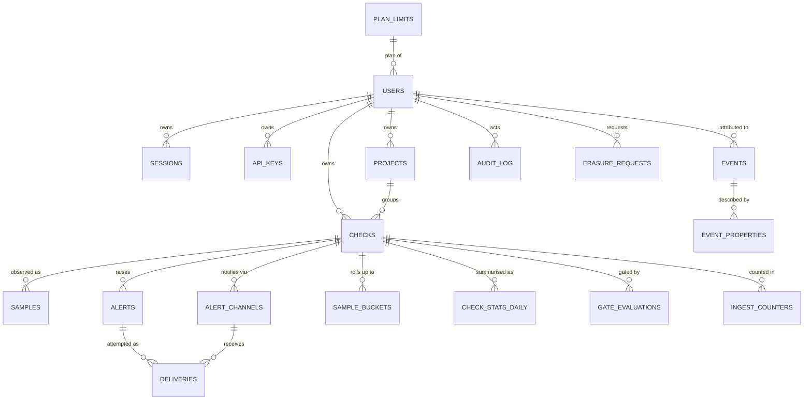

# LatencyLedger — Database Schema

SQLite ≥3.40, stdlib-only access (`sqlite3` in Python). Single host, single
writer, WAL mode. Source of truth: `migrations/0001_init.sql` (+ `0002_indexes.sql`);
`db/schema.sql` is the consolidated standalone equivalent. Conventions from
`docs/db-spec.md`: UTC ISO-8601 TEXT timestamps (`YYYY-MM-DDTHH:MM:SS.sssZ` via
`strftime('%Y-%m-%dT%H:%M:%fZ','now')`), booleans `INTEGER 0/1` with `CHECK`,
enums as `TEXT … CHECK (… IN …)`, money as integer minor units, secrets stored
only as hashes, FKs declared inline and enforced per-connection
(`PRAGMA foreign_keys=ON`). `STRICT` tables deliberately not used (see db-spec §1).

## ERD



Relationship notes: one user → many checks; one check → many samples/alerts.
`checks.project_id` is nullable (`ON DELETE SET NULL`) so ungrouped checks and
P1 `projects` coexist. `samples` is the only unbounded-growth table; everything
else is bounded by user/check counts. P1/P2 tables (`status_pages`,
`page_components`, `chat_subscriptions`, `subscriptions`, `invoices`,
`data_exports`, `regions`, `teams`, `team_members`) are spec'd in
`docs/data-spec.md` §1.5–1.7 but not created until their feature ships — their
FK targets exist now, so those migrations are purely additive.

## Tables (20 incl. bookkeeping)

| Table | Purpose | Key constraints |
|---|---|---|
| `schema_migrations` | migration bookkeeping (bootstrapped by runner) | PK `version`, `checksum` sha256 |
| `plan_limits` | per-plan quota reference | PK `plan` ∈ free/pro/team; seeded in 0001 |
| `users` | account identity + plan | `email` UNIQUE NOCASE, FK→plan_limits, soft-delete `deleted_at` |
| `sessions` | server-side login sessions | opaque TEXT id, FK cascade, `expires_at>created_at` |
| `api_keys` | CI/API auth | `hash` UNIQUE (64-hex sha256), prefix for display, `revoked_at` |
| `projects` | grouping checks (P1, FK target) | FK cascade from users |
| `checks` | monitored URL + config | FKs user/project, `interval_sec`∈{60,300,900,3600}, public⇒slug |
| `samples` | raw latency fact table | FK cascade, `ms`∈[0,60000), `status` 100–599, `error_kind` enum, partial unique dedupe |
| `alerts` | regression/down/recovery instances | `delta_pct`, cooldown, ack FK SET NULL |
| `alert_channels` | email/webhook/chat destinations | FK cascade, `enabled` 0/1 |
| `deliveries` | delivery attempts per alert×channel | `attempts` 1–3, status 0 or 100–599 |
| `sample_buckets` | pre-aggregated chart points | PK(check,bucket_sec,bucket_start) |
| `check_stats_daily` | daily percentile rollup | PK(check,day), detector reads `baseline_p95` here |
| `gate_evaluations` | CI gate audit log | `pass` 0/1, budget/window |
| `events` | first-party analytics stream | JSON `properties` ≤4KB validated, indexes (kind,ts),(user,ts) |
| `event_properties` | EAV sidecar for hot props | PK(event_id,key) |
| `audit_log` | security action log | action enum, JSON detail |
| `scheduler_heartbeats` | scheduler liveness (ops KPI) | one row per tick |
| `ingest_counters` | ingest/detector counters | PK(check,day) |
| `erasure_requests` | right-to-erasure workflow | status enum, ≤30d pipeline |

## Indexes

`0001_init.sql` creates the hot-path indexes including
`samples(check_id, ts)` (`idx_samples_check_ts`) and `checks(next_check_at)` for
the scheduler due-scan. `0002_indexes.sql` adds perf/partial/covering indexes:
retention purge `samples(ts,check_id)`, dashboard covering
`samples(check_id,ts,ms,status)`, error drill-down, git_sha lookup, unacked
alert inbox, gate-fail sweep, events/audit reporting sweeps, session expiry GC.
Rollups (`sample_buckets`, `check_stats_daily`) are pure functions of `samples`
and rebuilt by the rollup job / `db/seed.py` (§5.3 of data-spec).

## Backup / restore (from docs/db-spec.md §6)

- **Online (preferred):** `sqlite3 data/latencyledger.db ".backup data/backups/http-ping-<ts>.db"` — transactional, safe while running. Copy off-host; hourly, keep 24h/7d/4w.
- **Stopped-server copy:** stop the server, `cp` the `.db` (plus `-wal` if present); never copy the live file alone.
- **Logical dump:** `.dump | gzip` for portable snapshots (includes `schema_migrations`).
- **Restore:** stop server → replace `.db`, delete stale `-wal`/`-shm` → start; boot runner applies newer migrations and refuses to listen if `foreign_key_check`/`integrity_check` fails. Verify `SELECT max(version) FROM schema_migrations`.
- **Restore test:** weekly job restores the newest off-host backup to scratch, runs `integrity_check` + smoke suite. RPO ≤1h, RTO ≤15min same host. True PITR is not provided by SQLite (see db-spec §6 for Litestream option).
- Also back up channel-secret encryption material — DB alone cannot decrypt `*_enc` config.

## Running

```bash
python -m db.migrations data/latencyledger.db   # apply migrations (idempotent)
python -m db.seed --reset                        # fresh DB + deterministic demo seed
```
