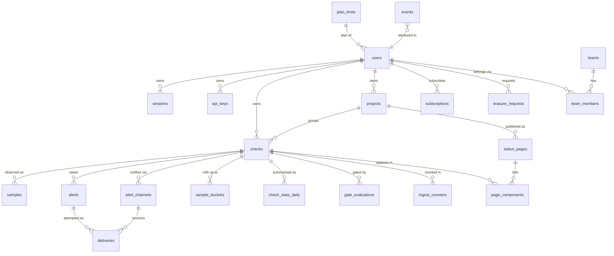

# LatencyLedger — Data Specification

> Companion to `docs/product-spec.md` (LatencyLedger: continuous API latency
> regression tracking with CI gates) and `docs/architecture.md` (Python 3.11+
> stdlib-only backend, SQLite storage, static frontend).
> Constraints honoured throughout: **stdlib-only backend, SQLite at launch,
> no external analytics SaaS required.** All analytics are computed in-process
> from first-party SQLite data.

---

## 1. Entity Catalog

### 1.1 Overview

28 entities in total: **9 core (P0, in `schema.sql`)**, **3 derived/rollup
(P0)**, **3 platform (P0)**, **4 product (P1)**, **3 billing/plan (P0/P1)**,
**3 future (P2, stubbed)**, **3 operational (P0)**. P2 entities are specified
now so P0 schemas do not need breaking migrations later; they are not created
until their feature ships.

| # | Entity (table) | Tier | Purpose |
|---|---|---|---|
| 1 | `users` | P0 core | Account identity + plan |
| 2 | `sessions` | P0 core | Server-side login sessions |
| 3 | `api_keys` | P0 core | CI / API authentication |
| 4 | `checks` | P0 core | A monitored URL + config |
| 5 | `samples` | P0 core | One latency observation (raw fact table) |
| 6 | `alerts` | P0 core | Regression alert instances |
| 7 | `alert_channels` | P0 core | Email/webhook destinations per check |
| 8 | `deliveries` | P0 core | Delivery attempts for alerts |
| 9 | `plan_limits` | P0 core | Per-plan quota reference table |
| 10 | `sample_buckets` | P0 derived | Pre-aggregated time buckets per check |
| 11 | `check_stats_daily` | P0 derived | Daily percentile rollup per check |
| 12 | `gate_evaluations` | P0 derived | CI gate pass/fail audit log |
| 13 | `events` | P0 platform | Product analytics event stream (first-party) |
| 14 | `event_properties` | P0 platform | EAV sidecar for event properties |
| 15 | `audit_log` | P0 platform | Security/privacy-sensitive action log |
| 16 | `projects` | P1 | Grouping checks (project → checks) |
| 17 | `status_pages` | P1 | Public status page per project |
| 18 | `page_components` | P1 | Check ↔ status-page membership |
| 19 | `chat_subscriptions` | P1 | Slack/Discord webhook destinations |
| 20 | `subscriptions` | P1 billing | Stripe/manual subscription state |
| 21 | `invoices` | P1 billing | Payment history (stub until billing) |
| 22 | `data_exports` | P1 billing | Export request/audit trail |
| 23 | `regions` | P2 future | Check provenance regions |
| 24 | `teams` | P2 future | Workspaces |
| 25 | `team_members` | P2 future | Team membership + roles |
| 26 | `scheduler_heartbeats` | P0 ops | Scheduler liveness self-monitoring |
| 27 | `ingest_counters` | P0 ops | Ingest/detector counters (ops KPIs) |
| 28 | `erasure_requests` | P0 ops | Right-to-erasure request workflow |

Conventions: all primary keys are `TEXT` (ULID-style / `secrets.token_urlsafe`)
except append-only fact tables (`samples`, `events`, `audit_log`) which use
`INTEGER PRIMARY KEY AUTOINCREMENT` for cheap range scans. Timestamps are UTC
ISO-8601 text (`YYYY-MM-DDTHH:MM:SSZ`, `datetime('now')`); no timezone-aware
types in SQLite. Durations in milliseconds (`REAL` for sub-ms precision).
Booleans are `INTEGER 0/1`. Every table that holds user data carries
`created_at`; mutable tables carry `updated_at`.

### 1.2 Core entities (P0)

#### `users`
| Column | Type | Notes |
|---|---|---|
| `id` | TEXT PK | `usr_` + token_urlsafe(12) |
| `email` | TEXT UNIQUE NOT NULL | lowercased, trimmed at write |
| `email_verified_at` | TEXT NULL | NULL until verified (P1) |
| `pw_hash` | TEXT NOT NULL | `pbkdf2-sha256$200000$salt$hash` (never reversible) |
| `plan` | TEXT NOT NULL DEFAULT 'free' | FK → `plan_limits.plan` |
| `display_name` | TEXT NULL | optional, user-set |
| `created_at` | TEXT NOT NULL | |
| `updated_at` | TEXT NOT NULL | |
| `deleted_at` | TEXT NULL | soft-delete marker (see §6 erasure) |

Indexes: `UNIQUE(email)`, `INDEX(plan)`.

#### `sessions`
| Column | Type | Notes |
|---|---|---|
| `id` | TEXT PK | opaque `secrets.token_urlsafe(32)` (cookie value) |
| `user_id` | TEXT NOT NULL FK → `users.id` ON DELETE CASCADE | |
| `created_at` | TEXT NOT NULL | |
| `expires_at` | TEXT NOT NULL | default 30 days |
| `last_seen_at` | TEXT | sliding idle timeout support |
| `ip_hash` | TEXT | SHA-256 of client IP, truncated (privacy §6) |
| `user_agent` | TEXT | truncated to 256 chars |

Index: `(user_id, expires_at)`. Expired rows purged nightly (retention §1.8).

#### `api_keys`
| Column | Type | Notes |
|---|---|---|
| `id` | TEXT PK | |
| `user_id` | TEXT NOT NULL FK → `users.id` CASCADE | |
| `label` | TEXT | user-chosen name, e.g. "CI prod" |
| `prefix` | TEXT NOT NULL | first 8 chars of key (`ll_` + 5) for display |
| `hash` | TEXT UNIQUE NOT NULL | SHA-256 hex of full key; full key shown once at creation |
| `created_at` | TEXT NOT NULL | |
| `last_used_at` | TEXT NULL | updated on successful auth |
| `revoked_at` | TEXT NULL | NULL = active; revocation is immediate |

Index: `(user_id)`, `UNIQUE(hash)`.

#### `checks`
| Column | Type | Notes |
|---|---|---|
| `id` | TEXT PK | `chk_` + token |
| `user_id` | TEXT NOT NULL FK → `users.id` CASCADE | owner |
| `project_id` | TEXT NULL FK → `projects.id` (P1) | NULL = ungrouped |
| `name` | TEXT NOT NULL | human label |
| `url` | TEXT NOT NULL | validated http(s), ≤2048 chars, SSRF-guarded |
| `interval_sec` | INTEGER NOT NULL | from plan-allowed set {60,300,900,3600} |
| `threshold_pct` | REAL NOT NULL DEFAULT 20 | regression sensitivity |
| `budget_ms` | REAL NULL | CI gate budget; NULL = no budget set |
| `is_public` | INTEGER NOT NULL DEFAULT 0 | public report enabled |
| `slug` | TEXT UNIQUE NULL | public report slug; generated when `is_public=1` |
| `last_checked_at` | TEXT NULL | scheduler bookkeeping |
| `next_check_at` | TEXT NULL | scheduler due-time |
| `created_at` / `updated_at` | TEXT NOT NULL | |

Indexes: `(user_id)`, `(next_check_at)` (scheduler due-scan), `UNIQUE(slug)`.

#### `samples` — the fact table
| Column | Type | Notes |
|---|---|---|
| `id` | INTEGER PK AUTOINCREMENT | append-only |
| `check_id` | TEXT NOT NULL FK → `checks.id` CASCADE | |
| `ts` | TEXT NOT NULL | observation time, UTC ISO-8601 |
| `ms` | REAL NULL | latency; NULL when request failed |
| `status` | INTEGER NULL | HTTP status; NULL on network error |
| `size_bytes` | INTEGER NULL | response body bytes read (≤1MB cap) |
| `error_kind` | TEXT NULL | `timeout`/`dns`/`connect`/`tls`/`other` |
| `git_sha` | TEXT NULL | commit annotation from CI ingest |
| `note` | TEXT NULL | free-form CI annotation, ≤512 chars |
| `source` | TEXT NOT NULL DEFAULT 'scheduler' | `scheduler` / `manual` / `ci` |

Composite index `(check_id, ts)` — the hot path for every chart/stats query.
`UNIQUE(check_id, ts, git_sha, source)` is **not** enforced (duplicate
ingestion handled in §5 dedupe, since scheduler clock skew makes strict
uniqueness brittle). Retention: raw samples expire per plan (`history_days`);
see §1.8.

#### `alerts`
| Column | Type | Notes |
|---|---|---|
| `id` | INTEGER PK AUTOINCREMENT | |
| `check_id` | TEXT NOT NULL FK → `checks.id` CASCADE | |
| `kind` | TEXT NOT NULL DEFAULT 'regression' | `regression` / `down` / `recovery` |
| `observed_p95` | REAL NOT NULL | p95 at fire time |
| `baseline_p95` | REAL NOT NULL | baseline it was compared against |
| `delta_pct` | REAL NOT NULL | `(observed-baseline)/baseline*100` |
| `cooldown_until` | TEXT NULL | per-check 6h suppression window |
| `created_at` | TEXT NOT NULL | |
| `acked_at` | TEXT NULL | user acknowledged/viewed |
| `acked_by` | TEXT NULL FK → `users.id` | |

Index: `(check_id, created_at DESC)`.

#### `alert_channels`
| Column | Type | Notes |
|---|---|---|
| `id` | TEXT PK | |
| `check_id` | TEXT NOT NULL FK → `checks.id` CASCADE | |
| `kind` | TEXT NOT NULL | `email` / `webhook` / `chat` (chat=P1) |
| `target` | TEXT NOT NULL | email address or HTTPS URL (validated) |
| `enabled` | INTEGER NOT NULL DEFAULT 1 | |
| `created_at` | TEXT NOT NULL | |

Index: `(check_id)`.

#### `deliveries`
| Column | Type | Notes |
|---|---|---|
| `id` | INTEGER PK AUTOINCREMENT | |
| `alert_id` | INTEGER NOT NULL FK → `alerts.id` CASCADE | |
| `channel_id` | TEXT NOT NULL FK → `alert_channels.id` CASCADE | |
| `status` | INTEGER NOT NULL | HTTP status from delivery; 0 = network failure |
| `attempts` | INTEGER NOT NULL DEFAULT 1 | retry counter (max 3, exp backoff) |
| `last_error` | TEXT NULL | truncated 512 chars |
| `delivered_at` | TEXT NULL | set on final success |
| `ts` | TEXT NOT NULL | attempt time |

Index: `(alert_id)`, `(channel_id, ts)`.

#### `plan_limits` — reference table
| Column | Type | Notes |
|---|---|---|
| `plan` | TEXT PK | `free` / `pro` / `team` |
| `max_checks` | INTEGER NOT NULL | 3 / 25 / 100 |
| `min_interval_sec` | INTEGER NOT NULL | 300 / 60 / 60 |
| `history_days` | INTEGER NOT NULL | 7 / 90 / 365 |
| `max_channels` | INTEGER NOT NULL | 1 / 5 / 20 |
| `ci_gates_per_day` | INTEGER NOT NULL | 10 / 1000 / 5000 |

Seeded at migration; enforced in app code on check-create and ingest.

### 1.3 Derived / rollup entities (P0)

#### `sample_buckets` — pre-aggregated chart points
| Column | Type | Notes |
|---|---|---|
| `check_id` | TEXT FK → `checks.id` CASCADE | part of PK |
| `bucket_start` | TEXT | part of PK; bucket width depends on range |
| `bucket_sec` | INTEGER | part of PK; 300 (5m) for 24h, 3600 for 7d/30d |
| `n` | INTEGER NOT NULL | sample count in bucket |
| `n_errors` | INTEGER NOT NULL DEFAULT 0 | |
| `avg_ms` / `p95_ms` / `min_ms` / `max_ms` | REAL NULL | NULL when `n=0` |
| `updated_at` | TEXT NOT NULL | |

PK `(check_id, bucket_sec, bucket_start)`. Populated by a scheduled rollup
job (every 5 min); charts read buckets, never raw `samples`, when range > 24h.
Rebuilt from `samples` on demand (backfill §5).

#### `check_stats_daily`
| Column | Type | Notes |
|---|---|---|
| `check_id` | TEXT FK → `checks.id` CASCADE | part of PK |
| `day` | TEXT (`YYYY-MM-DD`) | part of PK, UTC day |
| `n` / `n_errors` | INTEGER NOT NULL | |
| `min_ms` / `p50_ms` / `p95_ms` / `p99_ms` / `max_ms` / `avg_ms` | REAL NULL | |
| `uptime_pct` | REAL | `100*(1 - n_errors/n)` |
| `baseline_p95` | REAL NULL | rolling 7d median of daily p95 — detector input |
| `updated_at` | TEXT NOT NULL | |

PK `(check_id, day)`. The detector reads `baseline_p95` from here, not raw
samples, so detection is O(1) per ingest.

#### `gate_evaluations`
| Column | Type | Notes |
|---|---|---|
| `id` | INTEGER PK AUTOINCREMENT | |
| `check_id` | TEXT NOT NULL FK → `checks.id` CASCADE | |
| `user_id` | TEXT NOT NULL FK → `users.id` | evaluating principal |
| `budget_ms` | REAL NOT NULL | budget used for this evaluation |
| `observed_p95` | REAL NOT NULL | window p95 (last 50 samples default) |
| `window_n` | INTEGER NOT NULL | samples in evaluation window |
| `pass` | INTEGER NOT NULL | 1/0 |
| `git_sha` | TEXT NULL | |
| `created_at` | TEXT NOT NULL | |

Index: `(check_id, created_at DESC)`. Cap per plan (retention §1.8); this is
the audit trail for "why did CI fail".

### 1.4 Platform entities (P0)

#### `events` — first-party product analytics
| Column | Type | Notes |
|---|---|---|
| `id` | INTEGER PK AUTOINCREMENT | |
| `ts` | TEXT NOT NULL | event time |
| `kind` | TEXT NOT NULL | event name from taxonomy §3.1 |
| `user_id` | TEXT NULL FK → `users.id` | NULL for anonymous |
| `anon_id` | TEXT NULL | pre-signup anonymous id (cookie) |
| `session_id` | TEXT NULL | |
| `properties` | TEXT NOT NULL DEFAULT '{}' | JSON object, schema-validated per kind |
| `received_at` | TEXT NOT NULL | server receipt time (drift detection) |

Indexes: `(kind, ts)`, `(user_id, ts)`. No third-party sink; queried by the
admin analytics views in §4.

#### `event_properties` — optional EAV sidecar
Same columns as `events` minus `properties`, plus `key TEXT`, `value TEXT`,
PK `(event_id, key)`. Used only when a property needs SQL-side filtering
(e.g. `kind='check_created' AND value='pro'`). Hot properties are mirrored
here; the JSON column remains the source of truth.

#### `audit_log`
| Column | Type | Notes |
|---|---|---|
| `id` | INTEGER PK AUTOINCREMENT | |
| `ts` | TEXT NOT NULL | |
| `actor_id` | TEXT NULL FK → `users.id` | NULL for system |
| `action` | TEXT NOT NULL | `login`/`logout`/`key.created`/`key.revoked`/`check.deleted`/`data.erased`/`plan.changed`/`export.created` |
| `target_kind` / `target_id` | TEXT | |
| `detail` | TEXT | JSON, PII-scrubbed (§6) |
| `ip_hash` | TEXT NULL | |

Retention 13 months, then anonymised (§1.8).

### 1.5 Product entities (P1)

- **`projects`**: `id, user_id FK, name, created_at, updated_at`. 1:N to `checks`.
- **`status_pages`**: `id PK, user_id FK, project_id FK NULL, slug UNIQUE, title, is_public, created_at, updated_at`.
- **`page_components`**: `page_id FK, check_id FK, PK(page_id, check_id), position INT` — junction.
- **`chat_subscriptions`**: `id PK, check_id FK, provider ('slack'|'discord'), webhook_url (encrypted at rest in P1, see §6), created_at`.

### 1.6 Billing entities (P1, stubbed in P0)

- **`subscriptions`**: `id PK, user_id FK UNIQUE, provider ('stripe'|'manual'), status, current_period_end, created_at, updated_at`. P0 writes `manual` rows only (admin toggle).
- **`invoices`**: `id PK, subscription_id FK, amount_cents, currency, status, issued_at`.
- **`data_exports`**: `id PK, user_id FK, check_id FK, format, range_start, range_end, row_count, created_at, expires_at` — audit trail for §4 exports (also serves erasure evidence).

### 1.7 Future (P2) + operations entities (P0)

- **`regions`**: `code PK ('us-east','eu-west','ap-south'), name`. `checks.region_code FK` added by migration when P2 ships (nullable, defaults to single region).
- **`teams` / `team_members`**: `teams(id, name, owner_id FK)`; `team_members(team_id FK, user_id FK, role ('owner','member'), PK(team_id,user_id))`. `checks.team_id FK` nullable until P2.
- **`scheduler_heartbeats`**: `id PK, ts, last_scheduled_check_id, checks_due, samples_written, lag_ms` — one row per scheduler tick (30s), used for ops KPI §2. Feeds the 99.9% scheduler-uptime claim.
- **`ingest_counters`**: `check_id FK, day, ingested, rejected, gate_evals, PK(check_id, day)` — cheap daily counters so ops dashboards never scan `samples`.
- **`erasure_requests`**: `id PK, user_id FK, requested_at, status ('pending','processing','completed','rejected'), completed_at, method ('self_serve','email'), notes` — workflow state for §6.

### 1.8 Relationships (ERD)

Cardinality notes: one user → many checks; one check → many samples/alerts;
alerts are per-check (not per-user) so a check transfer (P2 teams) keeps its
history. `samples` is the only unbounded-growth table; everything else is
bounded by user/check counts.

### 1.9 Retention policy

| Data | Retention | Mechanism |
|---|---|---|
| `samples` (raw) | Per plan: free 7d, pro 90d, team 365d; hard-delete after | Nightly purge job deletes expired rows, then buckets/rollups are recomputed for affected ranges |
| `sample_buckets` | 2× plan history (cheap) | Same purge; buckets rebuilt from remaining samples |
| `check_stats_daily` | 2× plan history | Same |
| `gate_evaluations` | 90 days all plans | Nightly purge |
| `alerts` / `deliveries` | 13 months | Nightly purge (deliveries first) |
| `events` | 13 months, then aggregate-only (see §6 anonymisation) | Monthly rollup to `event_daily_counts` ad-hoc view, then delete raw |
| `sessions` expired | 30 days after expiry | Nightly purge |
| `audit_log` | 13 months, then PII-scrubbed aggregate | Monthly scrub job |
| `scheduler_heartbeats` | 30 days | Nightly purge |
| `ingest_counters` | 13 months | Nightly purge |
| `data_exports` files | 7 days after creation | Filesystem/object purge; row kept as evidence |
| Deleted user data | Hard delete ≤30 days after request | §6 erasure pipeline |

SQLite specifics: run `PRAGMA journal_mode=WAL; PRAGMA synchronous=NORMAL;`
and periodic `VACUUM` (weekly, low-traffic window) after large purges so file
size does not grow unboundedly. Purge jobs are idempotent and chunked
(≤10k rows/transaction) to avoid long write locks.

---

## 2. Metrics Dictionary

All KPIs are computed from first-party SQLite tables only. "Cadence" is how
often the value is (re)computed. Percentiles use the linear-interpolation
method in `stats.py` (same function used by the detector, so a KPI and the
alert it triggers can never disagree).

| # | KPI | Definition | Formula | Source tables | Cadence |
|---|---|---|---|---|---|
| K1 | **North Star: acted-on regression alerts** | # regression alerts the user viewed within 1h of delivery | `COUNT(alerts WHERE acked_at IS NOT NULL AND acked_at <= created_at + 1h AND kind='regression')` | `alerts` | Hourly |
| K2 | Activation rate | % of signups adding first check within 24h | `users_with_check_in_24h / signups` | `users`, `checks`, `events` (`signup_completed`) | Daily |
| K3 | Time-to-first-chart | Median minutes signup → first chart view | `median(events[chart_viewed].ts - users.created_at)` | `events`, `users` | Daily |
| K4 | W4 cohort retention | % of week-0 cohort active in week 4 (`chart_viewed` or `check_created`) | cohort query on `events` | `events` | Weekly |
| K5 | Weekly active checks | # distinct `check_id` with ≥1 sample in trailing 7d | `COUNT(DISTINCT check_id)` over `samples` | `samples` | Daily |
| K6 | Alert precision | % of alerts marked useful (acked → no disable within 7d) | `acked_and_still_enabled / acked` | `alerts`, `alert_channels`, `events` (`alert_disabled`) | Weekly |
| K7 | True regression rate | % of alerts where observed p95 stayed elevated ≥24h | evaluator over `check_stats_daily` | `alerts`, `check_stats_daily` | Weekly |
| K8 | Free→paid conversion | % of free users converting to paid within 90d | `new_paid / new_free` (cohort) | `users`, `subscriptions` | Monthly |
| K9 | MRR / Paying users | Sum of active subscription revenue | `SUM(amount_cents)` active subs | `subscriptions`, `invoices` | Monthly |
| K10 | Churn (monthly) | % of paid users cancelling in month | `cancelled / start_of_month_paid` | `subscriptions` | Monthly |
| K11 | Check-level uptime % | Per-check availability over window | `100 × (1 - n_errors/n)` | `check_stats_daily` | Daily |
| K12 | p50/p95/p99 latency (per check) | Percentiles of `ms` over window | linear interpolation on sorted `ms` | `samples` / `sample_buckets` | On read + daily rollup |
| K13 | Regression delta % | `(observed_p95 - baseline_p95)/baseline_p95 × 100` | as stated | `alerts`, `check_stats_daily` | Per alert (event) |
| K14 | Gate pass rate | % of CI gate evals passing | `SUM(pass)/COUNT(*)` | `gate_evaluations` | Daily |
| K15 | CI adoption | # distinct users with ≥1 gate eval in trailing 7d | `COUNT(DISTINCT user_id)` | `gate_evaluations` | Daily |
| K16 | Alert delivery success | % of deliveries succeeding within attempts | `delivered / total` per channel kind | `deliveries` | Daily |
| K17 | Public report shares | # public slugs created / views served | counts | `checks`, `events` (`report_viewed`) | Daily |
| K18 | Scheduler uptime | % of expected ticks present (30s cadence) | `ticks_present / ticks_expected` | `scheduler_heartbeats` | Hourly |
| K19 | Ingest p95 latency | p95 of server-side ingest handling time | percentile over request timings logged in `ingest_counters` + request log | `ingest_counters` | Hourly |
| K20 | Sample volume | # samples/day (total + per plan) | count | `samples` | Daily |
| K21 | Error rate (product) | 5xx responses per 1k requests | count from structured logs | app logs → `ingest_counters`-style rollup | Hourly |
| K22 | LTV (target) | `ARPU × avg lifetime months` (target ≥ 8 × $9 = $72) | cohort revenue | `invoices` | Monthly |

Targets from product spec §5: K2 ≥40%, K4 ≥25%, K6 ≥70%, K9 ≥$450 MRR in 6
months, K18 ≥99.9%, K19 <2s.

---

## 3. Analytics Pipeline

### 3.1 Event taxonomy

Product events are **server-emitted at the API layer** (not client-side
JavaScript beacons) — see §3.2 for rationale. Every event carries
`{kind, ts, user_id?, anon_id?, session_id?, properties{}}`. Schema is
validated server-side against the allowed property keys below; unknown keys
are rejected (400) rather than silently stored, so the taxonomy cannot drift.

| Event | Properties | Fires when |
|---|---|---|
| `signup_started` | `source` | register form submitted |
| `signup_completed` | `plan` | account created |
| `login_succeeded` / `login_failed` | `reason?` | auth attempt |
| `check_created` | `check_id, interval_sec, is_public, plan` | check added |
| `check_updated` | `check_id, changed_fields[]` | config edited |
| `check_deleted` | `check_id, sample_count` | check removed |
| `ping_now` | `check_id, n, error_n` | manual ping executed |
| `chart_viewed` | `check_id, range` | check detail rendered |
| `series_requested` | `check_id, range, bucket_sec, latency_ms` | API series call (internal perf) |
| `regression_detected` | `check_id, observed_p95, baseline_p95, delta_pct` | detector fires |
| `alert_sent` | `alert_id, check_id, channel_kind` | delivery attempted |
| `alert_delivered` | `alert_id, channel_kind, attempts` | delivery succeeded |
| `alert_failed` | `alert_id, channel_kind, error_kind` | retries exhausted |
| `alert_viewed` | `alert_id, check_id` | alert opened in UI (K1) |
| `alert_disabled` | `check_id, channel_kind` | user turns channel off (K6) |
| `api_key_created` | `label` | key issued |
| `api_key_revoked` | `key_id` | key revoked |
| `gate_evaluated` | `check_id, pass, budget_ms, observed_p95, git_sha?` | CI gate called |
| `sample_ingested` | `check_id, source, ms?, status?` | CI/manual ingest accepted |
| `sample_rejected` | `check_id, reason` | ingest validation failure |
| `public_report_toggled` | `check_id, is_public` | share enabled/disabled |
| `report_viewed` | `check_id, referrer?` | public link viewed (anon) |
| `export_created` | `check_id, format, range` | CSV/JSON export |
| `plan_changed` | `old_plan, new_plan` | upgrade/downgrade |

Never collected: response bodies, full URLs with query strings (host+path
only, query stripped), email addresses in properties, IP addresses (§6).

### 3.2 Ingestion: API-side vs client-side

**Decision: fully server-side at launch.** Rationale:

- The service already needs the API layer for auth/scheduler; emitting an
  event is one extra `INSERT` in the same request transaction (or a short
  async queue flush). Client-side beacons would need a JS snippet, CORS
  handling, bot filtering, and ad-blocker fallbacks — all out of scope for a
  stdlib-only sprint.
- Server-side events are trustworthy: they cannot be dropped by a closed
  tab, and `ts` is server time (no client clock skew in funnel timing).
- Anonymous pre-signup events use a first-party cookie (`anon_id`) set by the
  server; on signup the client sends `anon_id` once and the server links
  `events.anon_id → user_id` for one row-group. No fingerprinting.

Ingestion path: handler → `events.append(kind, props)` writes to an in-memory
queue (bounded, 10k) → background thread flushes in batches of ≤500 per
transaction, every ≤2s. Queue overflow drops low-priority kinds
(`chart_viewed`, `series_requested`) first and increments
`ingest_counters.rejected` — analytics loss must never block product
requests. `POST /api/v1/events` (client beacon) is a **P2** option, gated
behind plan limits, with the same schema validation.

### 3.3 Storage alignment with SQLite

- `events` is a normal indexed table (above); at sprint-1 scale (<1M rows)
  SQLite scans with `(kind, ts)` indexes are <50ms. No OLAP engine.
- Aggregation strategy: raw events → nightly job computes daily counts into
  an ad-hoc `event_daily_counts(kind, day, n)` view/table → admin dashboards
  read the daily table; deep dives read raw. After 13 months raw events are
  anonymised-then-deleted (§1.9), leaving only counts.
- WAL mode + single-writer queue: product write transactions hold the lock
  for milliseconds; event flushes are separate short transactions so
  analytics never starve the scheduler.
- Same-file growth guard: `events` + `samples` dominate file size; with
  `PRAGMA page_size=4096` and retention purges above, a 10k-user deployment
  stays <10GB. Postgres migration path (replace `db.py` adapter) is
  documented in architecture.md; the event/bucket schemas are portable
  (no SQLite-specific types beyond `AUTOINCREMENT`, which maps to any
  identity column).
- JSON `properties`: stored as TEXT; queried with `json_extract()` (built
  into SQLite ≥3.38). Hot filters mirrored to `event_properties` (§1.4).

---

## 4. Reporting

### 4.1 Admin analytics views (built-in, no external BI)

All views are stdlib-rendered HTML/canvas on `/admin/*` (role-gated,
requires `users.is_admin=1` — a flag added by migration; P0 admin is the
operator themselves). Each view reads the tables in §1 and prints the KPIs
in §2; no chart library, canvas sparklines consistent with the product UI.

| View | Route | Shows | KPIs |
|---|---|---|---|
| Growth | `/admin/growth` | signups/day, activation funnel, cohort retention table | K2, K3, K4 |
| Revenue | `/admin/revenue` | MRR, paying users, conversion, churn; plan mix | K8, K9, K10, K22 |
| Engagement | `/admin/engagement` | chart views, ping-now, public shares, alert viewed rate | K5, K17, K1 |
| Latency health (product) | `/admin/system` | scheduler uptime, ingest p95, sample volume, error rate | K18, K19, K20, K21 |
| Alert quality | `/admin/alerts` | precision, true-regression rate, delivery success by channel | K6, K7, K16 |
| CI adoption | `/admin/ci` | gate evals/day, pass rate, distinct CI users | K14, K15 |

### 4.2 Export formats (user-facing per check, §P1 story 13)

- **CSV**: `GET /api/checks/{id}/export?format=csv&from=…&to=…` — columns
  `ts,ms,status,size_bytes,git_sha,note,source`; streamed (generator, not
  full materialisation); respects plan `history_days`; auth required.
- **JSON**: `?format=json` — array of objects with the same fields plus
  `check_id`; paginated at 10k rows/page with `?cursor=` (id-based).
- Exports are recorded in `data_exports` (audit + evidence for erasure).
- Format is generated in-process (stdlib `csv`/`json`); no external service.

---

## 5. Data Quality

### 5.1 Validation rules (write-time)

| Rule | Applies to | Enforcement |
|---|---|---|
| `ms` must be ≥0 and < 60,000 (60s ceiling, sampler timeout is 10s) | `samples`, gate `p95_ms` | reject 422 with `error: invalid_ms` |
| `status` integer 100–599 or NULL | `samples` | reject 422 |
| `ts` must parse as ISO-8601 UTC; reject if >5min in future or > plan history in past | `samples` | reject 422 (`future_ts` / `stale_ts`) |
| `git_sha` must match `^[0-9a-f]{7,40}$` if present | `samples` | reject 422 |
| `note` ≤512 chars; `label` ≤64 | `samples`, `api_keys` | reject 422 / truncate-with-flag for `note` |
| `url` http(s) only, ≤2048 chars, SSRF-guarded (no private/loopback) | `checks` | reject 422 (arch. Security) |
| `email` valid shape, lowercased | `users` | reject 400; dup → 409 |
| `interval_sec` ∈ plan-allowed set and ≥ plan `min_interval_sec` | `checks` | reject 422 `plan_limit` |
| Event `kind` ∈ taxonomy; property keys ∈ per-kind allowlist; JSON ≤4KB | `events` | reject 400 |
| Percentile inputs: `n≥1` else NULL (never 0) | rollups | NULL + `n=0` |

All SQL is parameterised; constraints (`UNIQUE`, `FK`, `CHECK`) are declared
in `schema.sql` so a bug in app code cannot silently corrupt data.

### 5.2 Dedupe

- **Sample ingestion** (`POST /api/v1/checks/{id}/samples`): client sends
  `client_sample_id` (UUID, P1 addition to payload); server checks
  `UNIQUE(check_id, client_sample_id)` — duplicate deliveries return the
  original row (`200 {deduped:true}`) instead of double-counting. Until P1,
  a 60s window dedupe on `(check_id, ts, ms, status, git_sha)` is applied
  in code.
- **Scheduler samples** are naturally unique by monotonic tick; idempotency
  comes from `next_check_at` being advanced only after a committed insert.
- **Events**: `anon_id → user_id` linking runs once per signup; re-runs are
  no-ops (guarded by `signup_completed` presence).
- **Deliveries**: retry reuses the same `deliveries.id`, incrementing
  `attempts` — one row per (alert, channel), never one per attempt.

### 5.3 Backfill approach

- **Rollups from raw**: `sample_buckets` / `check_stats_daily` can be fully
  rebuilt from `samples` at any time (they are pure functions of it). A
  `rebuild_rollups(check_id?, from, to)` admin/CLI function recomputes
  chunked by day; used after purges, schema migrations, and seed loading.
- **Late/backfilled CI samples**: accepted if within plan history and
  `ts` passes §5.1; rollups for affected (check, day) are recomputed
  incrementally. Backfills beyond history are rejected (`stale_ts`) — by
  design, history is append-forward-only.
- **Migration safety**: `PRAGMA user_version` ordered migrations; a new
  column is added nullable or with a default so existing rows need no
  backfill; any *derived* column added later is backfilled by the rollup
  rebuild, never by hand-edits.
- **Detector continuity**: after a rebuild, `baseline_p95` is recomputed
  from the rebuilt daily series; the 6h `cooldown_until` survives rebuilds
  (stored on `alerts`, not derived).

---

## 6. Privacy

### 6.1 PII inventory

| Data element | Where | Category | Necessity |
|---|---|---|---|
| Email address | `users.email` | Direct identifier | Auth, alert delivery |
| Password hash | `users.pw_hash` | Credential (one-way) | Auth |
| Display name | `users.display_name` | Identifier (optional) | UI |
| Session IP | `sessions.ip_hash` (hashed) | Pseudonymous | Abuse detection |
| API key hash/prefix | `api_keys.hash/prefix` | Credential (one-way) | CI auth |
| Monitored URL | `checks.url` | Potentially sensitive (internal hostnames) | Core product |
| Alert target (email/webhook URL) | `alert_channels.target` | Identifier / secret | Delivery |
| Chat webhook URL | `chat_subscriptions.webhook_url` | Secret (bearer capability) | Delivery |
| Client IP (logs, audit) | logs, `audit_log.ip_hash` | Pseudonymous | Security (hashed) |
| `anon_id` (first-party cookie) | `events.anon_id` | Pseudonymous | Funnel attribution |
| Public-report slug | `checks.slug` | Capability token | Sharing |

Never stored: request/response bodies, query strings of monitored URLs,
API key plaintext (after creation response), payment card data (Stripe-hosted
in P1; only subscription state is local), precise geolocation.

### 6.2 Anonymisation

- IPs are stored only as truncated SHA-256 hashes (rotate salt yearly).
- `events.anon_id` is a random token; no fingerprinting, no cross-site data.
- After 13 months, raw `events`/`audit_log` are reduced to aggregate counts
  (KPI history preserved, per-user attribution dropped) before deletion.
- `check_stats_daily` / `sample_buckets` are inherently non-personal
  (latency numbers) and are retained as aggregates after user erasure.
- `chat_subscriptions.webhook_url` encrypted at rest (stdlib `hashlib`-based
  stream cipher is **not** suitable — use `cryptography`-free approach:
  rely on filesystem permissions + document LUKS/full-disk encryption in
  self-host docs; revisit if a stdlib AES is not available). Marked as a
  known gap with a P1 action item.

### 6.3 Right-to-erasure / deletion design

Self-serve (`DELETE /api/auth/me`, P1) and by-email request both write an
`erasure_requests` row (`status=pending`) and run the pipeline; target
completion ≤30 days, typical <24h:

1. **Revoke**: delete `sessions`, set `api_keys.revoked_at`, disable
   `alert_channels`.
2. **Anonymise identity**: `users.email → erased_<id>@deleted.invalid`,
   `pw_hash` cleared, `display_name` NULL, `deleted_at` set.
3. **Delete user data**: `checks` (CASCADE → `samples`, `alerts`,
   `deliveries`, `sample_buckets`, `check_stats_daily`,
   `gate_evaluations`, `ingest_counters`, `page_components`,
   `chat_subscriptions`, `alert_channels`), `projects`, `status_pages`,
   `data_exports` files, `events` rows with `user_id` (or anonymise
   `anon_id` linkage), `event_properties`.
4. **Keep (legal/aggregate)**: `audit_log` rows keep `action` + `ts` but
   drop `actor_id` linkage; `invoices`/`subscriptions` retained per
   accounting obligations (flagged in `notes`); daily aggregate counts
   retained (no PII).
5. **Verify**: job re-queries every table for the `user_id` and asserts
   zero rows remain (except the allowed keep-list); writes
   `audit_log(action='data.erased')` and sets `erasure_requests.status=
   'completed'` with evidence in `notes`.
6. **Degradation path**: if a step fails, `status='processing'` with the
   failing step recorded; retry with backoff; operator alerted after 3
   failures.

Public report links die with the check (`slug` removed → 404, per product
spec AC). Erasure is irreversible; the UI warns and requires typed
confirmation + password re-entry.

---

## 7. Seed / Demo Dataset Design (development)

`app/seed.py` (stdlib only, deterministic — fixed PRNG seed `42`) creates a
demo account + dataset into a *separate* dev SQLite file (`dev.db`), never
production. Run: `python -m app.seed [--reset]`.

**Contents** (all synthetic, no real user data):

- 1 demo user: `demo@latencyledger.local` / password `demo1234` (documented
  in README; plan `pro`), plus 2 users on `free`/`team` for plan testing.
- 6 checks:
  | Check | Profile |
  |---|---|
  | `api.example.com/users` | healthy, ~180ms p95, slight diurnal wave |
  | `api.example.com/checkout` | one regression incident (p95 210→389ms, day 5–6, SHA `abc1234`) |
  | `api.example.com/search` | noisy, 5% errors |
  | `status.example.com` | intermittent downtime (3 outages) |
  | `slow.example.com` | chronically slow, p95 ~900ms |
  | `ci-gate.example.com` | paired with gate evals (70% pass) |
- 30 days of samples at 5-minute effective density (≈8.6k/check, ≈52k total)
  generated from a seeded random walk + injected incidents; `git_sha` values
  cycle through 5 fake SHAs.
- Derived data: rollups rebuilt via §5.3; 3 regression alerts + 2 down
  alerts with matching `deliveries` (email + webhook, mixed success);
  200 `gate_evaluations`; ~500 `events` across the §3.1 taxonomy;
  1 public report slug so `/r/{slug}` works out of the box.
- `--reset` drops and recreates the dev DB; seed is idempotent if re-run
  without `--reset` (skips when demo user exists).

This dataset exercises every KPI in §2 and every admin view in §4, and is
what the QA spec's detector/stats tests run against (plus the injected
day-5 regression as a known-positive fixture).

---

## 8. Market Note (researched)

**Concept:** LatencyLedger — continuous API latency regression tracking with
CI gates for solo devs and small teams (2–20 devs).

### Sources (researched market sizing)

- Broad website-monitoring market: ~$3.8B (2025) → $9.6B (2034), CAGR ~10.8%
  (Dataintelo).
- Website availability/uptime monitoring (narrower): $2.41B (2024) →
  $7.48B (2033), CAGR ~13.7% (Growth Market Reports).
- Website failure monitoring (narrowest): ~$380M (2025) → $921M (2034),
  CAGR ~9.3% (Intel Market Research).
- Synthetic monitoring: $3.18B (2025) → $14.61B (2035), CAGR 16.5%, with
  **API monitoring the fastest-growing segment at 19.2% CAGR** (Market
  Research Future).
- Synthetic API monitoring specifically: $1.21B (2024) → $5.17B (2033),
  CAGR 17.6% (DataIntelo).
- Product spec positioning (§1, §7): the broader uptime market is crowded
  ($8.5B, ~9% CAGR per the product spec's research), while latency-drift +
  CI-gating for small teams is thinly served.

### TAM / SAM / SOM

| Layer | Definition | Estimate | Basis |
|---|---|---|---|
| **TAM** | Global synthetic/website monitoring spend | **~$3.2–3.8B (2025)**, growing 16.5%/yr (synthetic) | Market Research Future; Dataintelo |
| **SAM** | API/latency monitoring for SMBs & indie developers (self-serve SaaS, <$50/mo, no APM agent) | **~$400–600M** | Synthetic API monitoring $1.21B (2024) × SMB/self-serve share (~40%), triangulated against narrow failure-monitoring $380M; web-app/API subset of the $2.4B availability market |
| **SOM** | LatencyLedger's obtainable share in 18 months: 500 paying users × $9–29/mo | **~$54k–174k ARR** (500 users, blended $15/mo ≈ $90k ARR) | Product-spec milestone: 50 users / $450 MRR at 6 months; SOM assumes 10× that at 18 months via OSS/self-host funnel |

**Reading:** TAM is large and growing double-digit, but it is *not* our
market — Datadog/New Relic own the enterprise APM slice. The wedge is the
SAM: developers who need "did my API get slower, and should this PR ship?"
without an agent or an enterprise contract. SAM is big enough ($400M+) that
even 0.02% share is a real business; SOM is deliberately conservative and
bottom-up (user count × price) rather than top-down market share. Risks to
the thesis: incumbent uptime tools adding drift detection (Better Stack is
the closest threat), and SQLite/single-process scaling ceilings if a check
succeeds (mitigation: documented Postgres path).

---

*Sources for §8 (researched 2026-11-08): [Dataintelo — website monitoring](https://dataintelo.com/report/global-website-monitoring-market), [Dataintelo — synthetic API monitoring](https://dataintelo.com/report/global-synthetic-api-monitoring-market), [Market Research Future — synthetic monitoring](https://www.marketresearchfuture.com/reports/synthetic-monitoring-market), [Growth Market Reports — website availability monitoring](https://growthmarketreports.com/industry-reports/website-availability-monitoring-market), [Intel Market Research — website failure monitoring](https://www.intelmarketresearch.com/website-failure-monitoring-market-23683).*
