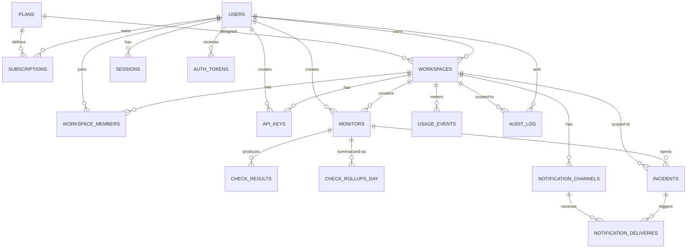

# http-ping — Database Specification

| Field | Value |
|---|---|
| Product | http-ping (HTTP latency / uptime monitoring SaaS) |
| Database | SQLite (stdlib access only, no ORM / no driver package) |
| Deployment | Single host (single VPS/container), single writer process |
| Target SQLite | ≥ 3.40 (uses `STRICT`-compatible typing discipline, `RETURNING`, generated columns guarded) |
| Spec status | v1.0 — normative for implementation |

> **Design intent.** http-ping began as a CLI that fires N `fetch()` calls at a URL and
> prints min/max/avg latency. The SaaS version turns that into a multi-tenant monitoring
> product: users register, create **monitors** (URLs + check interval), a background
> prober records **check results** with latency and status, rollups feed dashboards,
> failures open **incidents** and fire **notification channel** deliveries, and plans
> meter usage. This spec is the single source of truth for the schema.
>
> **Stdlib constraint.** All DB access goes through the runtime's standard library
> (`node:sqlite` in Node ≥ 22.5, `sqlite3` in Python stdlib) — no `better-sqlite3`,
> no Knex/Prisma/Drizzle, no ORM. SQL lives in this document and in versioned
> migration files; application code issues hand-written, parameterized SQL.

---

## 1. Complete schema DDL (SQLite dialect)

Conventions used throughout:

- Primary keys: `INTEGER PRIMARY KEY` (rowid alias) named `id`, unless a natural
  composite key is clearer. `AUTOINCREMENT` is **not** used (it prevents rowid reuse
  only at the cost of a bookkeeping table; gaps in ids are acceptable and SQLite
  docs recommend against it for non-audit purposes).
- Timestamps: UTC ISO-8601 text (`YYYY-MM-DDTHH:MM:SS.sssZ`), generated application-side
  or via `strftime('%Y-%m-%dT%H:%M:%fZ','now')`. Never store local time or epoch
  integers in application tables (epoch `INTEGER` is permitted only for high-volume
  derived columns where the format is documented).
- Booleans: `INTEGER NOT NULL DEFAULT 0 CHECK (col IN (0,1))`.
- Enums: `TEXT NOT NULL CHECK (col IN (...))` — no lookup-table indirection for
  closed sets of ≤ 8 values.
- Money: integer minor units (cents), never floats.
- Secrets: store only hashes (scrypt/argon2/bcrypt digest, see Security spec);
  plaintext passwords and raw API keys are never persisted.
- Every table has `created_at`; mutable tables also have `updated_at`.
- Foreign keys are declared inline and **enforced** (`PRAGMA foreign_keys = ON`,
  set per-connection at boot — SQLite does not persist this pragma).
- `STRICT` tables are deliberately **not** used: they would force `ANY` typing on
  `json` columns and break on older distro SQLite builds. Type affinity + `CHECK`
  constraints give equivalent safety.

```sql
-- ============================================================
-- http-ping schema v1  (0001_init.sql — consolidated baseline)
-- ============================================================

PRAGMA journal_mode = WAL;
PRAGMA foreign_keys = ON;
PRAGMA busy_timeout = 5000;
PRAGMA synchronous = NORMAL;

-- ---------- migration bookkeeping ----------
CREATE TABLE schema_migrations (
    version     TEXT    NOT NULL PRIMARY KEY,   -- e.g. '0001_init'
    name        TEXT    NOT NULL,
    applied_at  TEXT    NOT NULL DEFAULT (strftime('%Y-%m-%dT%H:%M:%fZ','now')),
    checksum    TEXT    NOT NULL                -- sha256 of the migration file
);
-- Note: this table is created by the runner BEFORE any migration runs
-- (bootstrap), so it must not also appear in 0001_init's own body.

-- ---------- 1. plans ----------
CREATE TABLE plans (
    id               INTEGER PRIMARY KEY,
    slug             TEXT    NOT NULL UNIQUE,          -- 'free' | 'pro' | 'team'
    name             TEXT    NOT NULL,
    price_cents      INTEGER NOT NULL DEFAULT 0 CHECK (price_cents >= 0),
    currency         TEXT    NOT NULL DEFAULT 'USD'
                             CHECK (length(currency) = 3),
    billing_interval TEXT    NOT NULL DEFAULT 'month'
                             CHECK (billing_interval IN ('month','year','once')),
    max_monitors     INTEGER NOT NULL DEFAULT 5  CHECK (max_monitors >= 0),
    max_workspace_members INTEGER NOT NULL DEFAULT 1 CHECK (max_workspace_members >= 0),
    min_interval_sec INTEGER NOT NULL DEFAULT 60 CHECK (min_interval_sec >= 10),
    retention_days   INTEGER NOT NULL DEFAULT 30 CHECK (retention_days >= 1),
    is_active        INTEGER NOT NULL DEFAULT 1 CHECK (is_active IN (0,1)),
    created_at       TEXT    NOT NULL DEFAULT (strftime('%Y-%m-%dT%H:%M:%fZ','now')),
    updated_at       TEXT    NOT NULL DEFAULT (strftime('%Y-%m-%dT%H:%M:%fZ','now'))
);
CREATE INDEX idx_plans_active ON plans (is_active) WHERE is_active = 1;

-- ---------- 2. users ----------
CREATE TABLE users (
    id                 INTEGER PRIMARY KEY,
    email              TEXT    NOT NULL UNIQUE COLLATE NOCASE,
    email_verified_at  TEXT,
    password_hash      TEXT    NOT NULL,               -- scrypt/argon2 digest, never plaintext
    display_name       TEXT    NOT NULL DEFAULT '',
    timezone           TEXT    NOT NULL DEFAULT 'UTC',
    locale             TEXT    NOT NULL DEFAULT 'en',
    is_admin           INTEGER NOT NULL DEFAULT 0 CHECK (is_admin IN (0,1)),
    is_suspended       INTEGER NOT NULL DEFAULT 0 CHECK (is_suspended IN (0,1)),
    last_login_at      TEXT,
    created_at         TEXT    NOT NULL DEFAULT (strftime('%Y-%m-%dT%H:%M:%fZ','now')),
    updated_at         TEXT    NOT NULL DEFAULT (strftime('%Y-%m-%dT%H:%M:%fZ','now')),
    CHECK (email LIKE '%@%')
);
CREATE INDEX idx_users_created ON users (created_at);

-- ---------- 3. auth_tokens (email verify / password reset, single-use) ----------
CREATE TABLE auth_tokens (
    id           INTEGER PRIMARY KEY,
    user_id      INTEGER NOT NULL REFERENCES users(id) ON DELETE CASCADE,
    kind         TEXT    NOT NULL CHECK (kind IN ('email_verify','password_reset')),
    token_hash   TEXT    NOT NULL,                     -- hash of the emailed token
    expires_at   TEXT    NOT NULL,
    consumed_at  TEXT,
    created_at   TEXT    NOT NULL DEFAULT (strftime('%Y-%m-%dT%H:%M:%fZ','now'))
);
CREATE UNIQUE INDEX uq_auth_tokens_hash ON auth_tokens (token_hash);
CREATE INDEX idx_auth_tokens_user ON auth_tokens (user_id, kind, expires_at);

-- ---------- 4. sessions (refresh tokens) ----------
CREATE TABLE sessions (
    id            INTEGER PRIMARY KEY,
    user_id       INTEGER NOT NULL REFERENCES users(id) ON DELETE CASCADE,
    token_hash    TEXT    NOT NULL UNIQUE,             -- hash of the refresh token
    user_agent    TEXT    NOT NULL DEFAULT '',
    ip_address    TEXT    NOT NULL DEFAULT '',
    expires_at    TEXT    NOT NULL,
    revoked_at    TEXT,
    created_at    TEXT    NOT NULL DEFAULT (strftime('%Y-%m-%dT%H:%M:%fZ','now'))
);
CREATE INDEX idx_sessions_user ON sessions (user_id) WHERE revoked_at IS NULL;
CREATE INDEX idx_sessions_expiry ON sessions (expires_at) WHERE revoked_at IS NULL;

-- ---------- 5. subscriptions ----------
CREATE TABLE subscriptions (
    id                  INTEGER PRIMARY KEY,
    user_id             INTEGER NOT NULL REFERENCES users(id) ON DELETE CASCADE,
    plan_id             INTEGER NOT NULL REFERENCES plans(id),
    status              TEXT    NOT NULL DEFAULT 'trialing'
                                CHECK (status IN ('trialing','active','past_due','canceled','paused')),
    provider            TEXT    NOT NULL DEFAULT 'none' CHECK (provider IN ('none','stripe','paddle')),
    provider_customer_id TEXT,
    provider_sub_id     TEXT,
    current_period_start TEXT,
    current_period_end   TEXT,
    trial_ends_at       TEXT,
    cancel_at_period_end INTEGER NOT NULL DEFAULT 0 CHECK (cancel_at_period_end IN (0,1)),
    canceled_at         TEXT,
    created_at          TEXT    NOT NULL DEFAULT (strftime('%Y-%m-%dT%H:%M:%fZ','now')),
    updated_at          TEXT    NOT NULL DEFAULT (strftime('%Y-%m-%dT%H:%M:%fZ','now'))
);
CREATE UNIQUE INDEX uq_subscriptions_provider
    ON subscriptions (provider, provider_sub_id) WHERE provider_sub_id IS NOT NULL;
CREATE INDEX idx_subscriptions_user ON subscriptions (user_id, status);
CREATE INDEX idx_subscriptions_period_end ON subscriptions (current_period_end)
    WHERE status IN ('trialing','active');

-- ---------- 6. workspaces (tenancy boundary) ----------
CREATE TABLE workspaces (
    id          INTEGER PRIMARY KEY,
    owner_user_id INTEGER NOT NULL REFERENCES users(id) ON DELETE RESTRICT,
    name        TEXT    NOT NULL CHECK (length(trim(name)) > 0),
    slug        TEXT    NOT NULL,                      -- url-safe, unique per owner app-wide
    plan_id     INTEGER NOT NULL REFERENCES plans(id),
    is_personal INTEGER NOT NULL DEFAULT 0 CHECK (is_personal IN (0,1)),
    created_at  TEXT    NOT NULL DEFAULT (strftime('%Y-%m-%dT%H:%M:%fZ','now')),
    updated_at  TEXT    NOT NULL DEFAULT (strftime('%Y-%m-%dT%H:%M:%fZ','now'))
);
CREATE UNIQUE INDEX uq_workspaces_slug ON workspaces (slug);
CREATE INDEX idx_workspaces_owner ON workspaces (owner_user_id);

-- ---------- 7. workspace_members ----------
CREATE TABLE workspace_members (
    workspace_id INTEGER NOT NULL REFERENCES workspaces(id) ON DELETE CASCADE,
    user_id      INTEGER NOT NULL REFERENCES users(id) ON DELETE CASCADE,
    role         TEXT    NOT NULL DEFAULT 'member'
                        CHECK (role IN ('owner','admin','member','viewer')),
    invited_at   TEXT,
    accepted_at  TEXT,
    created_at   TEXT    NOT NULL DEFAULT (strftime('%Y-%m-%dT%H:%M:%fZ','now')),
    PRIMARY KEY (workspace_id, user_id)
);
CREATE INDEX idx_workspace_members_user ON workspace_members (user_id);

-- ---------- 8. api_keys ----------
CREATE TABLE api_keys (
    id           INTEGER PRIMARY KEY,
    workspace_id INTEGER NOT NULL REFERENCES workspaces(id) ON DELETE CASCADE,
    user_id      INTEGER NOT NULL REFERENCES users(id) ON DELETE CASCADE,
    name         TEXT    NOT NULL DEFAULT '',
    key_prefix   TEXT    NOT NULL,                     -- e.g. 'hp_live_' + first 8 chars, for display
    key_hash     TEXT    NOT NULL UNIQUE,              -- sha256 of the raw key
    scopes       TEXT    NOT NULL DEFAULT 'read'       -- space-separated: read write admin
                        CHECK (scopes <> ''),
    last_used_at TEXT,
    revoked_at   TEXT,
    expires_at   TEXT,
    created_at   TEXT    NOT NULL DEFAULT (strftime('%Y-%m-%dT%H:%M:%fZ','now'))
);
CREATE INDEX idx_api_keys_ws ON api_keys (workspace_id) WHERE revoked_at IS NULL;
CREATE INDEX idx_api_keys_user ON api_keys (user_id);

-- ---------- 9. monitors ----------
CREATE TABLE monitors (
    id               INTEGER PRIMARY KEY,
    workspace_id     INTEGER NOT NULL REFERENCES workspaces(id) ON DELETE CASCADE,
    created_by_user_id INTEGER NOT NULL REFERENCES users(id) ON DELETE RESTRICT,
    name             TEXT    NOT NULL CHECK (length(trim(name)) > 0),
    url              TEXT    NOT NULL CHECK (url LIKE 'http://%' OR url LIKE 'https://%'),
    method           TEXT    NOT NULL DEFAULT 'GET' CHECK (method IN ('GET','HEAD','POST')),
    interval_sec     INTEGER NOT NULL DEFAULT 60 CHECK (interval_sec >= 10),
    timeout_ms       INTEGER NOT NULL DEFAULT 10000 CHECK (timeout_ms BETWEEN 500 AND 60000),
    expected_status  TEXT    NOT NULL DEFAULT '2xx',    -- '2xx' | '3xx' | exact like '200'
    follow_redirects INTEGER NOT NULL DEFAULT 1 CHECK (follow_redirects IN (0,1)),
    max_redirects    INTEGER NOT NULL DEFAULT 5 CHECK (max_redirects BETWEEN 0 AND 10),
    headers_json     TEXT    NOT NULL DEFAULT '{}' CHECK (json_valid(headers_json)),
    body_json        TEXT,                              -- optional request body for POST
    is_enabled       INTEGER NOT NULL DEFAULT 1 CHECK (is_enabled IN (0,1)),
    current_status   TEXT    NOT NULL DEFAULT 'unknown'
                             CHECK (current_status IN ('unknown','up','down','paused')),
    last_checked_at  TEXT,
    last_success_at  TEXT,
    consecutive_failures INTEGER NOT NULL DEFAULT 0 CHECK (consecutive_failures >= 0),
    notify_after_failures INTEGER NOT NULL DEFAULT 2 CHECK (notify_after_failures >= 1),
    recover_after_successes INTEGER NOT NULL DEFAULT 1 CHECK (recover_after_successes >= 1),
    last_incident_id INTEGER,                           -- FK added post-hoc (see migrations §5)
    created_at       TEXT    NOT NULL DEFAULT (strftime('%Y-%m-%dT%H:%M:%fZ','now')),
    updated_at       TEXT    NOT NULL DEFAULT (strftime('%Y-%m-%dT%H:%M:%fZ','now'))
);
CREATE INDEX idx_monitors_ws ON monitors (workspace_id, is_enabled, created_at);
CREATE INDEX idx_monitors_status ON monitors (current_status);
CREATE INDEX idx_monitors_next_check ON monitors (is_enabled, last_checked_at);

-- ---------- 10. check_results (raw probe samples — highest volume) ----------
CREATE TABLE check_results (
    id            INTEGER NOT NULL,
    monitor_id    INTEGER NOT NULL REFERENCES monitors(id) ON DELETE CASCADE,
    checked_at    TEXT    NOT NULL,
    status        TEXT    NOT NULL CHECK (status IN ('up','down','timeout','error')),
    http_status   INTEGER CHECK (http_status BETWEEN 100 AND 599),
    latency_ms    INTEGER CHECK (latency_ms IS NULL OR latency_ms >= 0),
    dns_ms        INTEGER,
    connect_ms    INTEGER,
    tls_ms        INTEGER,
    ttfb_ms       INTEGER,
    bytes         INTEGER CHECK (bytes IS NULL OR bytes >= 0),
    error_kind    TEXT,                                 -- e.g. 'ENOTFOUND','ECONNREFUSED','CERT_EXPIRED'
    error_message TEXT,
    PRIMARY KEY (monitor_id, checked_at, id)
) WITHOUT ROWID;
-- WITHOUT ROWID + composite PK: rows cluster by (monitor_id, time), which is
-- exactly the access pattern for history queries and TTL deletes. `id` keeps
-- ordering deterministic when two checks land in the same millisecond.
CREATE INDEX idx_check_results_time ON check_results (checked_at);

-- ---------- 11. check_rollups_day (denormalized daily aggregates) ----------
CREATE TABLE check_rollups_day (
    monitor_id    INTEGER NOT NULL REFERENCES monitors(id) ON DELETE CASCADE,
    day           TEXT    NOT NULL,                     -- 'YYYY-MM-DD' (UTC)
    checks        INTEGER NOT NULL DEFAULT 0 CHECK (checks >= 0),
    successes     INTEGER NOT NULL DEFAULT 0 CHECK (successes >= 0),
    failures      INTEGER NOT NULL DEFAULT 0 CHECK (failures >= 0),
    latency_min_ms INTEGER,
    latency_max_ms INTEGER,
    latency_sum_ms INTEGER NOT NULL DEFAULT 0 CHECK (latency_sum_ms >= 0),
    latency_p50_ms INTEGER,
    latency_p95_ms INTEGER,
    latency_p99_ms INTEGER,
    uptime_pct    REAL    NOT NULL DEFAULT 100.0 CHECK (uptime_pct BETWEEN 0 AND 100),
    PRIMARY KEY (monitor_id, day),
    CHECK (successes + failures = checks)
);
CREATE INDEX idx_rollups_day_recency ON check_rollups_day (day);

-- ---------- 12. incidents ----------
CREATE TABLE incidents (
    id            INTEGER PRIMARY KEY,
    monitor_id    INTEGER NOT NULL REFERENCES monitors(id) ON DELETE CASCADE,
    workspace_id  INTEGER NOT NULL REFERENCES workspaces(id) ON DELETE CASCADE,
    status        TEXT    NOT NULL DEFAULT 'open'
                        CHECK (status IN ('open','acknowledged','resolved')),
    opened_at     TEXT    NOT NULL,
    last_seen_at  TEXT    NOT NULL,
    resolved_at   TEXT,
    failure_count INTEGER NOT NULL DEFAULT 0 CHECK (failure_count >= 0),
    first_error   TEXT,
    last_error    TEXT,
    acknowledged_by_user_id INTEGER REFERENCES users(id) ON DELETE SET NULL,
    acknowledged_at TEXT,
    created_at    TEXT    NOT NULL DEFAULT (strftime('%Y-%m-%dT%H:%M:%fZ','now')),
    updated_at    TEXT    NOT NULL DEFAULT (strftime('%Y-%m-%dT%H:%M:%fZ','now')),
    CHECK (resolved_at IS NULL OR resolved_at >= opened_at)
);
CREATE INDEX idx_incidents_monitor ON incidents (monitor_id, status, opened_at);
CREATE INDEX idx_incidents_ws_open ON incidents (workspace_id, status, opened_at)
    WHERE status <> 'resolved';
CREATE INDEX idx_incidents_opened ON incidents (opened_at);

-- ---------- 13. notification_channels ----------
CREATE TABLE notification_channels (
    id            INTEGER PRIMARY KEY,
    workspace_id  INTEGER NOT NULL REFERENCES workspaces(id) ON DELETE CASCADE,
    kind          TEXT    NOT NULL CHECK (kind IN ('email','slack','webhook','pagerduty')),
    name          TEXT    NOT NULL DEFAULT '',
    -- kind-specific payload, validated shape per kind in app code:
    --   email:     { address }
    --   slack:     { webhook_url_enc }   (encrypted at rest; key never in DB)
    --   webhook:   { url, secret_enc }
    --   pagerduty: { routing_key_enc }
    config_json   TEXT    NOT NULL DEFAULT '{}' CHECK (json_valid(config_json)),
    is_enabled    INTEGER NOT NULL DEFAULT 1 CHECK (is_enabled IN (0,1)),
    created_at    TEXT    NOT NULL DEFAULT (strftime('%Y-%m-%dT%H:%M:%fZ','now')),
    updated_at    TEXT    NOT NULL DEFAULT (strftime('%Y-%m-%dT%H:%M:%fZ','now'))
);
CREATE INDEX idx_channels_ws ON notification_channels (workspace_id, is_enabled);

-- ---------- 14. notification_deliveries (one row per channel × incident event) ----------
CREATE TABLE notification_deliveries (
    id            INTEGER PRIMARY KEY,
    incident_id   INTEGER NOT NULL REFERENCES incidents(id) ON DELETE CASCADE,
    channel_id    INTEGER NOT NULL REFERENCES notification_channels(id) ON DELETE CASCADE,
    event         TEXT    NOT NULL CHECK (event IN ('opened','acknowledged','resolved','reminder')),
    status        TEXT    NOT NULL DEFAULT 'queued'
                        CHECK (status IN ('queued','sending','sent','failed','skipped')),
    attempts      INTEGER NOT NULL DEFAULT 0 CHECK (attempts >= 0),
    next_attempt_at TEXT,
    last_error    TEXT,
    sent_at       TEXT,
    created_at    TEXT    NOT NULL DEFAULT (strftime('%Y-%m-%dT%H:%M:%fZ','now')),
    UNIQUE (incident_id, channel_id, event)
);
CREATE INDEX idx_deliveries_due ON notification_deliveries (status, next_attempt_at)
    WHERE status IN ('queued','failed');
CREATE INDEX idx_deliveries_incident ON notification_deliveries (incident_id);

-- ---------- 15. usage_events (append-only metering) ----------
CREATE TABLE usage_events (
    id            INTEGER PRIMARY KEY,
    workspace_id  INTEGER NOT NULL REFERENCES workspaces(id) ON DELETE CASCADE,
    kind          TEXT    NOT NULL CHECK (kind IN ('checks','monitors','members','api_calls','incidents')),
    quantity      INTEGER NOT NULL DEFAULT 1 CHECK (quantity >= 0),
    period        TEXT    NOT NULL,                     -- 'YYYY-MM'
    occurred_at   TEXT    NOT NULL DEFAULT (strftime('%Y-%m-%dT%H:%M:%fZ','now')),
    PRIMARY KEY (workspace_id, period, kind, occurred_at, id)
) WITHOUT ROWID;
CREATE INDEX idx_usage_ws_period ON usage_events (workspace_id, period, kind);

-- ---------- 16. audit_log (append-only, security-relevant actions) ----------
CREATE TABLE audit_log (
    id            INTEGER PRIMARY KEY,
    actor_user_id INTEGER REFERENCES users(id) ON DELETE SET NULL,
    workspace_id  INTEGER REFERENCES workspaces(id) ON DELETE SET NULL,
    action        TEXT    NOT NULL,                     -- e.g. 'monitor.created'
    entity_type   TEXT    NOT NULL,                     -- e.g. 'monitor'
    entity_id     INTEGER,
    ip_address    TEXT    NOT NULL DEFAULT '',
    details_json  TEXT    NOT NULL DEFAULT '{}' CHECK (json_valid(details_json)),
    created_at    TEXT    NOT NULL DEFAULT (strftime('%Y-%m-%dT%H:%M:%fZ','now'))
);
CREATE INDEX idx_audit_ws_time ON audit_log (workspace_id, created_at);
CREATE INDEX idx_audit_actor ON audit_log (actor_user_id, created_at);

-- ---------- 17. app_settings (key/value operational config) ----------
CREATE TABLE app_settings (
    key         TEXT PRIMARY KEY,
    value       TEXT NOT NULL DEFAULT '',
    updated_at  TEXT NOT NULL DEFAULT (strftime('%Y-%m-%dT%H:%M:%fZ','now'))
);

-- ---------- 18. outbox (transactional side-effect queue) ----------
CREATE TABLE outbox (
    id            INTEGER PRIMARY KEY,
    topic         TEXT    NOT NULL,                     -- e.g. 'incident.opened'
    payload_json  TEXT    NOT NULL CHECK (json_valid(payload_json)),
    status        TEXT    NOT NULL DEFAULT 'pending'
                        CHECK (status IN ('pending','processing','done','dead')),
    attempts      INTEGER NOT NULL DEFAULT 0 CHECK (attempts >= 0),
    next_attempt_at TEXT,
    last_error    TEXT,
    created_at    TEXT    NOT NULL DEFAULT (strftime('%Y-%m-%dT%H:%M:%fZ','now')),
    processed_at  TEXT
);
CREATE INDEX idx_outbox_due ON outbox (status, next_attempt_at) WHERE status <> 'done';
```

**Table count: 19** (including `schema_migrations` and `app_settings`; 17 domain tables).
**Secondary index count: 29** (unique indexes included; see §4 for the
index-to-query mapping). Counting every `CREATE [UNIQUE] INDEX` statement above:

| # | Index | Serves |
|---|---|---|
| 1 | `idx_plans_active` (partial) | plan listing |
| 2 | `idx_users_created` | admin user list, growth charts |
| 3 | `uq_auth_tokens_hash` | token consume |
| 4 | `idx_auth_tokens_user` | token GC / per-user audit |
| 5 | `idx_sessions_user` (partial) | logout-all, session list |
| 6 | `idx_sessions_expiry` (partial) | session GC |
| 7 | `uq_subscriptions_provider` (partial unique) | Stripe/Paddle webhook idempotency |
| 8 | `idx_subscriptions_user` | "my plan" lookup |
| 9 | `idx_subscriptions_period_end` (partial) | billing reconciliation job |
| 10 | `uq_workspaces_slug` | slug collision check / routing |
| 11 | `idx_workspaces_owner` | "my workspaces" |
| 12 | `idx_workspace_members_user` | membership resolution |
| 13 | `idx_api_keys_ws` (partial) | key management UI |
| 14 | `idx_api_keys_user` | per-user key audit |
| 15 | `idx_monitors_ws` | monitor list per workspace |
| 16 | `idx_monitors_status` | fleet status overview |
| 17 | `idx_monitors_next_check` | prober scheduler scan |
| 18 | `idx_check_results_time` | TTL pruning, global retention job |
| 19 | `idx_rollups_day_recency` | rollup rebuild / backfill |
| 20 | `idx_incidents_monitor` | incident history per monitor |
| 21 | `idx_incidents_ws_open` (partial) | open-incident inbox |
| 22 | `idx_incidents_opened` | incident SLA / MTTR analytics |
| 23 | `idx_channels_ws` | channel list per workspace |
| 24 | `idx_deliveries_due` (partial) | delivery worker poll |
| 25 | `idx_deliveries_incident` | delivery timeline per incident |
| 26 | `idx_usage_ws_period` | quota checks, billing |
| 27 | `idx_audit_ws_time` | workspace audit trail |
| 28 | `idx_audit_actor` | actor audit trail |
| 29 | `idx_outbox_due` (partial) | outbox worker poll |

(Unique indexes `uq_auth_tokens_hash`, `uq_subscriptions_provider`,
`uq_workspaces_slug` are UNIQUE; the rest are plain or partial. The PKs on
`check_results` and `usage_events` are WITHOUT ROWID clustered indexes
by construction.)

---

## 2. ERD (mermaid) and relationship explanation



**Relationship notes**

- `users 1—N subscriptions`: a user may have history (trial → paid → canceled) but
  at most one *live* subscription; enforced in application code + the
  `idx_subscriptions_user` lookup, because a partial unique index on
  `user_id WHERE status IN (...)` is possible but makes provider webhook
  upserts awkward. See §4 Q7.
- `users 1—N workspaces` (`owner_user_id`): every workspace has exactly one owner.
  Personal workspaces are ordinary workspaces with `is_personal = 1` and a single
  member — no separate table.
- `workspaces N—M users` via `workspace_members` (composite PK). The owner is
  also a member with role `owner`; ownership transfer = role swap in one
  transaction.
- `monitors.workspace_id` is the **tenancy boundary**: every monitor, incident,
  channel, delivery, usage event, and API key hangs off a workspace, and every
  query is workspace-scoped first. There is no cross-workspace query in
  application code except admin/GC jobs.
- `monitors.last_incident_id` is a *cache* pointer into `incidents`, not a
  second source of truth; FK is added in a follow-up migration (`0002`) because
  of the circular reference (incidents → monitors, monitors → incidents).
  It lets the monitor list render "open incident since …" without a JOIN.
- `check_results` is append-only and references `monitors` with
  `ON DELETE CASCADE`: deleting a monitor deletes its history in the same
  transaction, satisfying data-retention/erasure requests.
- `incidents` duplicates `workspace_id` (denormalized) so the open-incident
  inbox doesn't need to join through `monitors`.
- `notification_deliveries` has `UNIQUE (incident_id, channel_id, event)` —
  the idempotency key that makes redelivery after a crash safe.
- `audit_log` and `usage_events` are append-only; no `updated_at`, no UPDATE
  path in application code.
- `outbox` is the transactional-outbox pattern: business writes and the
  "please send this notification" row commit atomically; a worker drains
  `outbox` and materializes `notification_deliveries`. This closes the
  "incident recorded but notification lost" gap without distributed
  transactions.

---

## 3. Normalization analysis

**Target form: BCNF for all entity tables.** Each fact is stored once:

- Plan limits live on `plans`, not copied onto `subscriptions` or `workspaces`
  (changing a plan's quota updates one row and applies to every subscriber).
- Monitor configuration (`url`, `interval_sec`, thresholds) lives on `monitors`;
  `check_results` stores only observed facts (status, latencies, error).
- Latency statistics are *derived* and live in `check_rollups_day`, not
  recomputed from raw rows on every dashboard load (see acceptable
  denormalization below).
- `current_status`, `consecutive_failures`, `last_checked_at` on `monitors` are
  a **materialized cache** of the most recent check outcome. Strictly, they are
  derivable from `check_results`, but the prober scheduler and monitor list
  would otherwise scan the latest result per monitor per poll. The cache is
  updated in the *same transaction* as the check-result insert, so it cannot
  drift; retention jobs never touch it.

**Where 1NF is bent, and why it is safe**

- JSON columns (`headers_json`, `body_json`, `config_json`, `details_json`,
  `payload_json`) hold **schemaless, write-rarely, read-whole** documents:
  custom HTTP headers, channel config, audit context. They are never filtered
  or joined on (SQLite JSON functions are available for the rare debug query,
  but no index depends on them). Storing them as JSON avoids a family of
  one-column tables per channel kind. Channels *are* polymorphic by `kind`,
  which is the one deliberate 1NF/3NF relaxation: four channel kinds share a
  table with a `kind` discriminator and a `config_json` payload whose shape is
  validated in application code per kind. Splitting into four tables would
  quadruple the delivery-join logic for a closed set of 4 kinds.
- `scopes` on `api_keys` is a space-separated token list (`read write`),
  checked non-empty. Scope sets are tiny (≤ 3 tokens); a join table would be
  over-engineering. Never query by scope in SQL — check in application code
  after loading the key row.
- `expected_status` (`'2xx'`, `'200'`) is a mini-DSL in one column; matching
  logic lives in the prober. Splitting into `expected_status_class` +
  `expected_status_code` columns would still leave the DSL.

**Where denormalization is acceptable (deliberate, bounded)**

1. `check_rollups_day` — aggregates recomputed from `check_results` on write
   (incremental UPSERT in the same transaction as the check insert) and
   rebuildable from raw data at any time. If rollups and raw data ever
   disagree, raw data wins and rollups are rebuilt (§4 Q14).
2. `monitors.current_status` / `last_incident_id` — caches described above.
3. `incidents.workspace_id` — copied from the monitor's workspace at open time
   so inbox queries are single-table. Monitors never change workspace
   (moving = delete + recreate), so the copy cannot go stale.
4. `users.email` is the login key with `COLLATE NOCASE` — emails are stored
   as-typed (for display) and compared case-insensitively; uniqueness holds
   under the collation.

**What is NOT denormalized**

- No per-plan counters on `workspaces` (monitor counts are computed by
  `SELECT count(*) FROM monitors WHERE workspace_id = ?` — cheap with
  `idx_monitors_ws`, and always correct under concurrent prober writes).
- No `total_checks_24h` on monitors.
- No user-level aggregates duplicated across tables.

---

## 4. Query catalog (most important queries + expected indexes)

All queries are parameterized (`?` placeholders). "Index used" states the
index SQLite's planner should pick; verify with `EXPLAIN QUERY PLAN` in tests.

| # | Query | SQL sketch | Index used |
|---|---|---|---|
| Q1 | Login lookup | `SELECT * FROM users WHERE email = ?` (NOCASE unique) | `users.email` UNIQUE |
| Q2 | Consume auth token | `UPDATE auth_tokens SET consumed_at=? WHERE token_hash=? AND consumed_at IS NULL AND expires_at > ? RETURNING user_id` | `uq_auth_tokens_hash` |
| Q3 | Refresh-session rotation | `SELECT user_id FROM sessions WHERE token_hash=? AND revoked_at IS NULL AND expires_at > ?` then `UPDATE sessions SET revoked_at=? WHERE id=?` | `sessions.token_hash` UNIQUE |
| Q4 | My workspaces + role | `SELECT w.*, wm.role FROM workspaces w JOIN workspace_members wm ON wm.workspace_id=w.id WHERE wm.user_id=?` | `idx_workspace_members_user`, `idx_workspaces_owner` |
| Q5 | Create workspace (slug check) | `SELECT 1 FROM workspaces WHERE slug=?` → `INSERT INTO workspaces ...` | `uq_workspaces_slug` |
| Q6 | Verify API key | `SELECT * FROM api_keys WHERE key_hash=? AND revoked_at IS NULL` | `api_keys.key_hash` UNIQUE |
| Q7 | Current subscription | `SELECT s.*, p.* FROM subscriptions s JOIN plans p ON p.id=s.plan_id WHERE s.user_id=? AND s.status IN ('trialing','active','past_due') ORDER BY s.created_at DESC LIMIT 1` | `idx_subscriptions_user` |
| Q8 | Quota check (monitors) | `SELECT count(*) FROM monitors WHERE workspace_id=? AND is_enabled=1` | `idx_monitors_ws` |
| Q9 | Monitor list w/ latest status | `SELECT * FROM monitors WHERE workspace_id=? AND is_enabled=? ORDER BY created_at DESC` | `idx_monitors_ws` |
| Q10 | Prober scheduler scan | `SELECT id, url, interval_sec, last_checked_at FROM monitors WHERE is_enabled=1 AND (last_checked_at IS NULL OR last_checked_at <= overdue_cutoff) LIMIT ?` | `idx_monitors_next_check` |
| Q11 | Insert check + bump cache + close/reopen incident | single transaction: `INSERT INTO check_results ...`; `UPDATE monitors SET current_status=?, consecutive_failures=?, last_checked_at=? WHERE id=?`; `INSERT/UPDATE incidents ...` | PK `(monitor_id, checked_at, id)`; `idx_incidents_monitor` |
| Q12 | Monitor history (dashboard) | `SELECT checked_at, status, latency_ms FROM check_results WHERE monitor_id=? AND checked_at >= ? ORDER BY checked_at DESC LIMIT 500` | PK prefix `(monitor_id, checked_at)` |
| Q13 | Latency percentiles (raw window) | aggregate with `SUM(latency_ms)`, `MIN`, `MAX` over Q12 range; p50/p95/p99 computed in app code from ordered sample | PK prefix; no sort needed |
| Q14 | Daily rollup upsert | `INSERT INTO check_rollups_day (...) VALUES (...) ON CONFLICT(monitor_id, day) DO UPDATE SET checks=checks+excluded.checks, ...` | PK `(monitor_id, day)` |
| Q15 | Dashboard overview (per workspace, 30d) | `SELECT day, sum(checks), sum(successes), avg(uptime_pct) FROM check_rollups_day WHERE monitor_id IN (SELECT id FROM monitors WHERE workspace_id=?) AND day >= ? GROUP BY day` | PK `(monitor_id, day)`; `idx_rollups_day_recency` for backfill |
| Q16 | Open-incident inbox | `SELECT * FROM incidents WHERE workspace_id=? AND status<>'resolved' ORDER BY opened_at DESC` | `idx_incidents_ws_open` (partial) |
| Q17 | Incident timeline | `SELECT * FROM notification_deliveries WHERE incident_id=? ORDER BY created_at` | `idx_deliveries_incident` |
| Q18 | Delivery worker poll | `SELECT * FROM notification_deliveries WHERE status IN ('queued','failed') AND (next_attempt_at IS NULL OR next_attempt_at <= ?) ORDER BY created_at LIMIT ?` | `idx_deliveries_due` (partial) |
| Q19 | Outbox drain | `SELECT * FROM outbox WHERE status='pending' AND (next_attempt_at IS NULL OR next_attempt_at <= ?) LIMIT ?` | `idx_outbox_due` (partial) |
| Q20 | Usage this period (quota/billing) | `SELECT kind, sum(quantity) FROM usage_events WHERE workspace_id=? AND period=? GROUP BY kind` | `idx_usage_ws_period` |
| Q21 | Retention prune (check_results) | `DELETE FROM check_results WHERE checked_at < ?` (batched, §7) | `idx_check_results_time` |
| Q22 | Retention prune (rollups/audit) | `DELETE FROM check_rollups_day WHERE day < ?`; `DELETE FROM audit_log WHERE created_at < ?` (audit only per legal hold) | `idx_rollups_day_recency`, `idx_audit_ws_time` |
| Q23 | Admin: status fleet | `SELECT current_status, count(*) FROM monitors GROUP BY current_status` | `idx_monitors_status` |
| Q24 | Admin: user growth | `SELECT date(created_at) d, count(*) FROM users GROUP BY d ORDER BY d DESC LIMIT 90` | `idx_users_created` |
| Q25 | Enqueue incident notifications | `INSERT INTO notification_deliveries (incident_id, channel_id, event) SELECT ?, c.id, 'opened' FROM notification_channels c WHERE c.workspace_id=? AND c.is_enabled=1 ON CONFLICT DO NOTHING` + matching `INSERT INTO outbox ...` in same transaction | `idx_channels_ws`; UNIQUE `(incident_id, channel_id, event)` |

Complex joins are intentionally rare: the schema is a star around
`workspaces`/`monitors`, so most queries are single-table with an index
prefix. Any query that needs `EXPLAIN QUERY PLAN` to show more than one
index probe should be flagged in code review.

---

## 5. Migration system design

**Layout**

```
db/
  migrations/
    0001_init.sql            -- baseline (this document's DDL)
    0002_monitor_last_incident_fk.sql
    0003_...sql
    0004_...sql.down.sql     -- only where a safe down-migration exists
  seed/
    seed.sql                 -- demo dataset (see §8)
  seed.ts                    -- seed runner (stdlib only, parameterized)
```

**Rules**

1. **Versioned, immutable files.** Filename = `NNNN_snake_case_name.sql`,
   monotonically increasing, zero-padded to 4. A merged migration is never
   edited; fixes are new migrations. Each file starts with
   `PRAGMA foreign_keys=OFF;` … `BEGIN;` … `COMMIT;` and the runner wraps
   the whole file in one transaction.
2. **Boot-time runner.** On startup, before the HTTP server listens:
   1. Open the DB, `PRAGMA foreign_keys=ON`, `journal_mode=WAL`,
      `busy_timeout=5000`, `synchronous=NORMAL` (§7).
   2. Bootstrap: `CREATE TABLE IF NOT EXISTS schema_migrations (...)`.
   3. List `db/migrations/*.sql` in filename order; for each, compute
      `sha256(file)`.
   4. Skip versions already in `schema_migrations` (checksum mismatch →
      hard fail at boot with a clear error: "migration 0002 changed after
      being applied").
   5. Apply each pending migration in its own transaction; insert the
      `schema_migrations` row **in the same transaction** so a crash cannot
      leave a half-applied migration recorded as done.
   6. `PRAGMA foreign_key_check;` and `PRAGMA integrity_check;` after the
      run; fail boot on any violation.
3. **Idempotency.** Migrations must be safe to re-run in the sense that the
   runner never applies them twice (the `schema_migrations` guard). Within a
   migration, prefer `CREATE TABLE IF NOT EXISTS` / `CREATE INDEX IF NOT
   EXISTS` only in `0001_init` (fresh-install path); later migrations use
   plain DDL because the guard, not the DDL, provides idempotency.
   Data migrations use `INSERT ... ON CONFLICT DO NOTHING` / guarded `WHERE`.
4. **Up/down.** Down migrations (`NNNN_name.down.sql`) are provided **only**
   for additive DDL where reversal is trivially safe (drop an index, drop an
   added column — SQLite ≥ 3.35 supports `DROP COLUMN`). Down migrations
   are never run automatically; `down` is a manual, operator-invoked
   operation (`--migrate-down`) for dev/test. Destructive downs (dropping
   `check_results`, narrowing a column) are documented as "restore from
   backup" instead of shipping a lossy down file.
5. **SQLite DDL caveats respected.**
   - No `ALTER TABLE ... ADD COLUMN` with a non-constant default or a
     `CHECK` referencing other columns (SQLite restriction) — use the
     12-step table-rebuild procedure (`PRAGMA foreign_keys=OFF`, create new
     table, copy, drop, rename, re-create indexes, `foreign_key_check`)
     for such changes.
   - Circular FK (`monitors.last_incident_id → incidents`) is added in
     `0002` after both tables exist.
   - `PRAGMA foreign_keys` is per-connection; the runner sets it before
     every transaction, and the 12-step rebuild explicitly toggles it.
6. **Locking during migration.** The boot runner takes the write lock
   (`BEGIN IMMEDIATE`) before applying migrations, so a second process
   starting simultaneously blocks on `busy_timeout` and then sees the
   migrations as already applied. Only one writer process is expected
   (single-host deployment, §7); there is no migration lock table needed
   beyond the transaction itself.
7. **Testing.** CI runs: fresh DB → apply all migrations → `foreign_key_check`
   → seed → API smoke tests. A second CI job restores the latest nightly
   backup and runs the same suite (§6).

---

## 6. Backup / restore / restore-test procedure

**What to back up.** Three files, treated as a set (WAL mode!):

- `http-ping.db` — main database
- `http-ping.db-wal` — write-ahead log (only exists while the server runs)
- `http-ping.db-shm` — shared-memory index for WAL (rebuilt automatically;
  never needs independent backup)

Plus, outside the DB: the encryption key for channel secrets
(`config_json` holds `*_enc` ciphertext) and Stripe/Paddle webhook secrets —
backing up the DB without the key yields unusable channel config.

**Procedure A — online logical backup (preferred, no downtime)**

```bash
# sqlite3 .backup is transactional and safe while the server runs
sqlite3 data/http-ping.db ".backup --compress data/backups/http-ping-$(date -u +%Y%m%dT%H%M%SZ).db"
```

Equivalent from application code (stdlib): the `backup()` API
(`sqlite3.Connection.backup` in Python; `db.backup()` in `node:sqlite`).
Schedule hourly via cron/systemd timer, keep 24 hourly + 7 daily + 4 weekly.
Off-host copy (rsync/scp to object storage) is required — a backup on the
same disk does not survive disk loss.

**Procedure B — file copy (only when the server is stopped)**

```bash
systemctl stop http-ping          # or kill the process; confirm no -wal writer
cp data/http-ping.db data/backups/http-ping-YYYYMMDDTHHMMSSZ.db
# also copy data/http-ping.db-wal if it exists (it should be checkpointed
# to nothing on clean shutdown; copy it anyway if present)
```

Never `cp` the `.db` file alone while the server is running: you can capture
a torn page or miss un-checkpointed WAL frames.

**Procedure C — logical dump (portable / human-inspectable)**

```bash
sqlite3 data/http-ping.db .dump | gzip > data/backups/http-ping-YYYYMMDDTHHMMSSZ.sql.gz
```

The dump includes `schema_migrations` rows, so restore = `sqlite3 new.db <
dump.sql` then the boot runner sees nothing pending. Dumps are slow and large
for `check_results`; use them for schema/config snapshots and legal/export
requests, not as the primary backup.

**Restore**

1. Stop the server.
2. Restore the `.db` file (Procedure A/B backup) to `data/http-ping.db`,
   delete any stale `-wal`/`-shm` files.
3. Start the server; the boot runner applies any migrations newer than the
   backup, runs `foreign_key_check` + `integrity_check`, and refuses to
   listen if either fails.
4. Verify: `SELECT count(*) FROM schema_migrations;`,
   `SELECT max(version) FROM schema_migrations;`, spot-check
   `SELECT count(*) FROM users;` against pre-restore metrics.

**Restore test (automated, weekly)**

A restore-test job (nightly is fine) downloads the newest off-host backup to
a scratch directory, runs `PRAGMA integrity_check;`, runs the seed/smoke
suite against it, and pages the on-call if it fails. An untested backup is
not a backup.

**Point-in-time recovery (PITR) — honest limits**

SQLite has no built-in WAL archiving or binlog. True PITR is therefore
**not** provided. The practical approximations, in order of preference:

1. **Hourly `.backup` snapshots** → worst-case data loss ≈ 1 hour of check
   results and incident events. Acceptable for latency history (rollups can
   be rebuilt only for the retained window) and acceptable for incidents
   because the outbox + deliveries tables bound the loss to notifications
   queued in the last hour (re-derivable from incidents, §4 Q25).
2. **Manual `sqlite3 .dump` before risky deploys/migrations** → rollback =
   restore the dump (§5 rule 4).
3. **Litestream-style WAL streaming** (external tool, optional): streams WAL
   frames to object storage for near-continuous PITR. It is *not* stdlib,
   so it is an operational add-on choice, not part of the required stack —
   the schema and backup cadence above are designed so that adding it later
   is a no-op for application code.

**RPO/RTO targets:** RPO ≤ 1 h (hourly `.backup`), RTO ≤ 15 min
(single-file restore + boot checks) on the same host; ≤ 1 h including
provisioning a replacement host.

---

## 7. Concurrency & locking (single-host deployment)

**Pragmas (set on every connection at boot; SQLite does not persist them)**

```sql
PRAGMA journal_mode = WAL;        -- readers don't block the writer
PRAGMA busy_timeout = 5000;       -- 5s of lock retries before SQLITE_BUSY
PRAGMA synchronous = NORMAL;      -- safe with WAL; FULL only if power-loss
                                  -- durability of the last txn is paramount
PRAGMA foreign_keys = ON;         -- per-connection, never persisted
PRAGMA temp_store = MEMORY;       -- sorts for rollups stay in RAM
PRAGMA cache_size = -64000;       -- ~64 MB page cache
PRAGMA mmap_size = 268435456;     -- 256 MB mmap, fine on a VPS
PRAGMA wal_autocheckpoint = 1000; -- checkpoint every ~4 MB of WAL
```

**Write strategy**

- **One writer process.** The web server and the prober run in a single
  process (or the prober is a thread/child with its own connection but
  serialized writes). SQLite allows exactly one writer at a time; designing
  for one writer eliminates `SQLITE_BUSY` contention rather than coping
  with it.
- **Every write is a short transaction:** `BEGIN IMMEDIATE; … COMMIT;`.
  `BEGIN IMMEDIATE` acquires the reserved lock up front, so lock failures
  happen at transaction start (fast, retryable) instead of at `COMMIT`.
  Target transaction duration < 10 ms; the check-insert + cache-bump +
  incident-upsert transaction (§4 Q11) is the hottest and must stay small.
- **Batch the prober.** One prober tick = one transaction inserting all due
  checks (`INSERT INTO check_results VALUES (...), (...), ...`) plus their
  rollup upserts and monitor cache bumps — not one transaction per check.
  Batch size ~100.
- **Index maintenance is the write cost.** `check_results` has exactly one
  secondary index (`idx_check_results_time`) deliberately; adding more
  would tax every insert. Rollups are updated incrementally (Q14) instead
  of recomputed.
- **Reads are lock-free** under WAL: dashboards and API requests read from
  the WAL snapshot while the prober writes. `busy_timeout` absorbs the
  rare checkpoint contention.
- **Long-running jobs** (retention prune Q21, rollup rebuild) run in
  batches of 1,000 rows with a short sleep between batches, in their own
  transactions, so they never hold the write lock long enough to starve
  the prober. `DELETE ... WHERE checked_at < ? LIMIT 1000` in a loop.
- **`SQLITE_BUSY` handling:** application code retries `BEGIN IMMEDIATE`
  up to 5 times with 50–200 ms jittered backoff on top of `busy_timeout`,
  then surfaces a 503 (never a 500 with a stack trace) for user-facing
  writes. Read paths effectively never see `BUSY` under WAL.
- **No in-process mutex is needed beyond** serializing the prober's write
  transactions against the API's write transactions — both go through the
  same connection pool with `BEGIN IMMEDIATE`, and SQLite itself is the
  arbiter. A second *process* touching the DB file is supported only for
  the backup/CLI tooling in §6 (read-only or stopped-server).

**What breaks this model** (§9): a second host, a second writer process
with a high write rate, or sustained > ~10k writes/sec. At that point the
answer is a client-server database, not more SQLite tuning.

---

## 8. Seed / demo dataset design

`db/seed/seed.sql` + `db/seed/seed.ts` (stdlib runner, parameterized where
values vary). The seed is **idempotent**: safe to run repeatedly
(`INSERT ... ON CONFLICT DO NOTHING` everywhere; tokens/keys use fixed
test values).

**Contents**

| Entity | Seed data |
|---|---|
| `plans` | 3 rows: `free` ($0, 5 monitors), `pro` ($9/mo, 50 monitors, 30s min interval), `team` ($29/mo, 200 monitors, 10 members) |
| `users` | 3 demo users: `demo@http-ping.dev` (password `demo-demo-demo`, scrypt-hashed at seed time), `ops@http-ping.dev`, `admin@http-ping.dev` (`is_admin=1`) |
| `workspaces` | personal workspace per demo user + one shared `team` workspace owned by `ops@` with all three as members (`owner`/`admin`/`member`) |
| `subscriptions` | demo user: `trialing` pro subscription (trial ends +14d); ops user: `active` team subscription |
| `api_keys` | one `read` key + one `write` key for the team workspace; raw keys printed once by the seed runner (`hp_test_…`), only hashes stored |
| `monitors` | 6 monitors on the team workspace: `https://example.com` (60s), `https://httpbin.org/status/200` (60s), `https://httpbin.org/delay/2` (30s), a deliberately-failing `https://httpbin.org/status/500` (60s, opens an incident), one disabled monitor, one `HEAD` monitor |
| `check_results` | generated history: 14 days × 6 monitors at their intervals, sampled realistically (p50 ≈ 80–180 ms, jitter, one 2-hour "down" window for the failing monitor, a few `timeout` rows). Generated by `seed.ts` with a seeded PRNG so the dataset is byte-stable across runs |
| `check_rollups_day` | computed from the generated `check_results` by running the same rollup job used in production (§4 Q15) — never hand-written |
| `incidents` | 2 incidents for the failing monitor (one resolved with `failure_count=47`, one currently `open`), 1 `acknowledged` incident for the delay monitor |
| `notification_channels` | email channel for the team workspace (`ops@http-ping.dev`), Slack channel with a fake webhook URL, one disabled webhook channel |
| `notification_deliveries` | `sent` rows for the resolved incident's `opened` + `resolved` events, one `failed` row with `attempts=3` and a sample `last_error` to exercise the retry UI |
| `usage_events` | current-month `checks`/`monitors` counters matching the seeded monitor count |
| `audit_log` | `workspace.created`, `monitor.created` (×6), `incident.acknowledged` entries attributed to the demo users |
| `app_settings` | `prober.batch_size=100`, `retention.check_results_days=30` |

**Rules**

- Seed data uses a reserved fake domain (`http-ping.dev`, `example.com`,
  `httpbin.org`) and never real customer URLs.
- The seed runner refuses to run when `NODE_ENV=production` unless
  `--force` is passed; production installs start empty except `plans` and
  `app_settings` (loaded by `0001_init` data migration, not by seed).
- A `seed --reset` mode drops and recreates the DB file, runs all
  migrations, then seeds — used by CI and by the docs quickstart.

---

## 9. Growth projections

Assumptions: average monitor interval 60 s (free) / 30 s (pro+); one check
result ≈ 120 bytes on disk (row + index entry + overflow average);
rollups ≈ 1 row/monitor/day; 30-day raw retention on paid plans, 7-day on
free (enforced by Q21 prune); 2% of checks produce incident-adjacent writes.

| Users | Workspaces | Monitors | Checks/day | check_results / 30d | DB size (30d) | Rollups/day |
|---|---|---|---|---|---|---|
| 1,000 | ~1,200 | ~6,000 | ~8.6 M | ~260 M rows | ~30 GB ⚠️ | ~6,000 |
| 10,000 | ~12,000 | ~60,000 | ~86 M | ~2.6 B rows | ~300 GB ❌ | ~60,000 |
| 100,000 | ~120,000 | ~600,000 | ~860 M | ~26 B rows | ~3 TB ❌ | ~600,000 |

Those 30-day numbers show the real pressure point immediately: **raw check
history, not users or monitors**. Mitigations that keep SQLite viable well
into the 10k-user range:

1. **Retention tiering (default on):** free = 7 days raw, pro = 30 days raw,
   team = 90 days raw. Rollups are kept 13 months (dashboard + billing
   disputes), then pruned to monthly aggregates.
2. **Rollup-first reads:** dashboards and exports read `check_rollups_day`;
   raw rows are touched only for sub-day zoom-ins (Q12) and incident
   forensics. This keeps the hot query set on a table that grows at
   monitors/day, not checks/day.
3. **Sampling for low tiers:** free-tier checks older than 7 days are
   deleted by Q21; the rollup preserves the statistical record.
4. **`VACUUM` cadence:** after large prunes, run `PRAGMA incremental_vacuum`
   (with `auto_vacuum=INCREMENTAL` set at DB creation) weekly to return
   freed pages; full `VACUUM` only during maintenance windows (it rewrites
   the file and needs ~2× disk free).

**When SQLite is outgrown — decision thresholds**

| Signal | Threshold | Action |
|---|---|---|
| DB file size | > 50 GB sustained | Move `check_results` to a columnar/TSDB store; keep SQLite for everything else |
| Write throughput | > 5,000 check-inserts/sec sustained (batching helps; measure before acting) | Same as above, or shard probers by region with separate DBs per region |
| Writers | Need for a second host / second writer process | Migrate control plane (users, monitors, incidents) to Postgres; SQLite was never designed for multi-writer |
| Availability | RPO < 5 min or RTO < 1 min required | Client-server DB with streaming replication |
| Query shape | Ad-hoc analytics across tenants becomes common | Read replica / warehouse export (rollups + audit), not a bigger SQLite |

**Expected comfortable envelope:** a single VPS (4 vCPU, 8 GB RAM) with the
mitigations above handles **~1k–5k users, ~30k–150k monitors, ~5–20 M
checks/day** with p99 API latency unaffected, because the write path is
batched appends on a clustered PK and the read path is rollup-first.
The first component to outgrow SQLite will be `check_results` volume
(§9 table), and the migration path is incremental: extract exactly that
table to a time-series store, keep the remaining 17 tables — users,
monitors, incidents, billing — on SQLite for years longer.

---

## Appendix A. Bootstrap / connection snippet (stdlib)

```sql
-- executed once, in this order, by every process at boot:
PRAGMA journal_mode = WAL;
PRAGMA busy_timeout = 5000;
PRAGMA synchronous = NORMAL;
PRAGMA foreign_keys = ON;
PRAGMA temp_store = MEMORY;
PRAGMA auto_vacuum = INCREMENTAL;   -- only honoured at CREATE time
```

Node (`node:sqlite`, stdlib):

```js
import { DatabaseSync } from 'node:sqlite';
const db = new DatabaseSync('data/http-ping.db');
db.exec(`PRAGMA journal_mode=WAL; PRAGMA busy_timeout=5000;
         PRAGMA synchronous=NORMAL; PRAGMA foreign_keys=ON;`);
db.exec('BEGIN IMMEDIATE'); /* …writes… */ db.exec('COMMIT');
```

Python (`sqlite3`, stdlib):

```python
import sqlite3
conn = sqlite3.connect('data/http-ping.db', timeout=5.0, isolation_level=None)
conn.executescript("PRAGMA journal_mode=WAL; PRAGMA foreign_keys=ON; ...")
conn.execute("BEGIN IMMEDIATE")
```

## Appendix B. Index / table counts (summary)

- **Tables: 19 physical** — `schema_migrations`, `plans`, `users`,
  `auth_tokens`, `sessions`, `subscriptions`, `workspaces`,
  `workspace_members`, `api_keys`, `monitors`, `check_results`,
  `check_rollups_day`, `incidents`, `notification_channels`,
  `notification_deliveries`, `usage_events`, `audit_log`,
  `app_settings`, `outbox`. Excluding `schema_migrations` and
  `app_settings` bookkeeping: **17 domain tables**.
- **Secondary indexes: 29** (including partial and unique indexes, as
  listed in §1; WITHOUT ROWID clustered PKs excluded from that count).

## Appendix C. Open questions for the Product Manager

1. Exact SaaS tiers/prices and whether `plans` stays a static seed or
   becomes admin-editable (schema already supports both).
2. Raw check-results retention per tier (7/30/90 days assumed above).
3. Whether notification channels need per-monitor routing (schema assumes
   workspace-level channels; per-monitor routing = one extra join table).
4. Whether the prober is single-region at launch (schema assumes yes;
   multi-region probing adds a `probe_locations` table and a
   `check_results.location_id` column — a clean additive migration).
